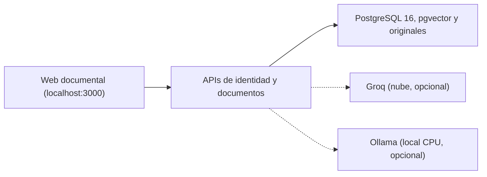

# Blandskron Documental

Aplicación de código abierto para la gestión y consulta documental, desarrollada por Blandskron. Permite cargar y organizar documentos, buscar por contenido (vectorial + texto completo) y hacer preguntas con respuestas que citan sus fuentes verificables. Desde la interfaz puedes revisar fragmentos recuperados, guardar conversaciones, exportar respuestas a PDF y elegir entre **Groq** (nube) u **Ollama local** sin editar código ni reiniciar contenedores.

La web usa React y TypeScript. Django administra la identidad y once servicios de aplicación cubren el recorrido documental (más el módulo opcional `KnowledgeStudioServices`). La ingesta y el chat calculan embeddings en CPU (`intfloat/multilingual-e5-small`). PostgreSQL 16 con `pgvector` almacena los vectores y el control de acceso se aplica en el servidor antes de construir el contexto.

| Guía | Contenido |
| --- | --- |
| [Arquitectura](docs/architecture.md) | Topología, límites de confianza, secuencia RAG/PDF y mapa de servicios. |
| [Operación local](docs/operations.md) | Requisitos mínimos, modos de despliegue, respaldos, restauración, solución de problemas y desinstalación. |
| [Verificación de entrega](docs/release/README.md) | Suite sintética, evidencias fechadas, auditoría de imágenes y alcance de CI. |
| [Backend](backend/README.md) | Inventario y documentación de los microservicios. |
| [Base de datos](scripts/database/README.md) | Esquema, roles de privilegios mínimos, preflight y migraciones. |
| [Extensibilidad LLM y MCP](docs/ADR_EXTENSIBILITY_LLM_MCP.md) | Proveedores Groq/Ollama/OpenAI-compatible y servidor MCP JSON-RPC 2.0 de solo lectura. |
| [Skills y documentación](docs/maintainers.md) | Convenciones y rutas de trabajo para colaboradores y agentes. |
| [Frontend](frontend/README.md) | Estructura, convenciones, diseño y pruebas de la interfaz. |



## Requisitos mínimos

- **Docker** con Compose v2 (compatible con `include` y `additional_contexts`) y **Git**.
- **Modo básico (embeddings locales CPU + Groq opcional):** 4 GB de RAM libre y ~3 GB de disco (la primera compilación descarga y verifica el modelo E5 de ~471 MB).
- **Modo local con Ollama (sin API key comercial):** 6–12 GB de RAM según el modelo elegido (p. ej. `gemma2:2b` ~1.6 GB / 4 GB RAM, `qwen2.5:3b` ~1.9 GB / 6 GB RAM, `mistral:7b` ~4.1 GB / 10+ GB RAM). No exige GPU.

## Instalación rápida (1 comando)

### Linux / macOS / Windows (PowerShell o Git Bash)

```bash
git clone https://github.com/Blandskron/AgenteIADocumental.git
cd AgenteIADocumental
docker compose up -d --build
```

No necesitas crear `.env` manualmente para empezar: `secrets-init` genera secretos aleatorios fuertes en un volumen persistente (`runtime_secrets`) conservándolos entre reinicios, sin incrustar contraseñas estáticas en las imágenes. Si ya tienes un `.env` personalizado, sus valores se respetan.

1. Abre [http://localhost:3000](http://localhost:3000).
2. **Primer registro:** en una instalación nueva, la pantalla de acceso abre automáticamente **Configuración inicial** para crear la primera cuenta administradora y el espacio principal (protegido transaccionalmente; las cuentas posteriores se crean como usuarios estándar sin privilegios administrativos).
3. **Configura la IA en `/settings/ai`:**
   - **Alternativa A — Groq (nube):** selecciona *Groq (Nube)*, introduce tu API key (se guarda cifrada con `secrets1.`), valida la conexión y elige el modelo. Nota: los planes y límites de cuota dependen de las condiciones vigentes de Groq.
   - **Alternativa B — Ollama (local, sin API key):** levanta el perfil opcional de Ollama (ver abajo), selecciona *Ollama (Local)* en `/settings/ai`, descarga un modelo del catálogo CPU autorizado viendo su progreso y prueba la consulta.
4. Sube un documento (`PDF`, `DOCX`, `TXT`, `Markdown` o imágenes con OCR) y haz una pregunta en **Chat** revisando las citas `[Fuente N]`.

## Modos de ejecución

- **Modo básico (por defecto):** `docker compose up -d --build` (embeddings locales, registro tradicional, Groq opcional desde la web).
- **Modo local con Ollama (sin enviar documentos a terceros para generación):**
  ```bash
  docker compose -f compose.yaml -f docker/compose/ollama.yml --profile local-llm up -d
  ```
  > Una vez construidas las imágenes y descargado el modelo elegido desde `/settings/ai`, el chat documental funciona sin conexión a internet. Ten presente que ejecutar modelos locales consume RAM, CPU, energía y almacenamiento de tu equipo.
- **Modo opcional — Knowledge Studio y servidor MCP de solo lectura (`POST /api/v1/mcp`):**
  ```bash
  STUDIO_ENABLED=true docker compose -f compose.yaml -f docker/compose/studio.yml --profile studio up -d --build
  ```
- **Integraciones opcionales (Google Login OIDC, Google Drive, SMTP):** arrancan deshabilitadas por defecto. Consulta [.env.example](.env.example) y [docs/operations.md](docs/operations.md) para habilitar `GOOGLE_OIDC_CLIENT_ID`, `GOOGLE_DRIVE_ENABLED=true` o `EMAIL_HOST` (necesario para recuperación automática de contraseña por correo).

> **Alcance y notas de seguridad:** Compose publica los puertos solo en loopback (`127.0.0.1`) para desarrollo y uso local; exponerlo a internet requiere TLS/proxy inverso y `AUTH_ENV=production`. La captura de firma incluida en los flujos documentales es un registro interno de aceptación y **no** constituye firma electrónica criptográfica ni legalmente certificada.

## Respaldos, actualización y desinstalación segura

- **Detener conservando datos (recomendado):** `docker compose down` (conserva PostgreSQL, documentos originales, modelos Ollama y secretos).
- **Eliminar volúmenes (borrado irreversible):** `docker compose down -v` — realiza siempre un respaldo antes.
- Consulta [docs/operations.md](docs/operations.md) para copias de seguridad, restauración, migración de PostgreSQL y solución de problemas.

## Colaboración

Usa las [issues del repositorio](https://github.com/Blandskron/AgenteIADocumental/issues) para reportar errores y proponer mejoras. Sigue las [pautas de contribución](CONTRIBUTING.md), las [instrucciones para colaboradores](AGENTS.md) y el [procedimiento de reporte privado de seguridad](SECURITY.md).

## Licencia y atribuciones

El código y la documentación propios de Blandskron se publican bajo la [licencia MIT](LICENSE) (© 2026 Blandskron). Los componentes de terceros conservan sus propias licencias: Noto Sans ([SIL OFL 1.1](backend/DocumentExportServices/app/infrastructure/pdf/fonts/LICENSE.txt)) y `intfloat/multilingual-e5-small` ([ficha del modelo](https://huggingface.co/intfloat/multilingual-e5-small/tree/614241f622f53c4eeff9890bdc4f31cfecc418b3)).
