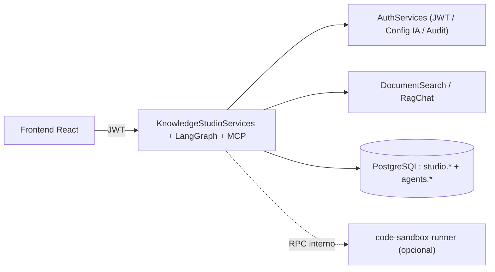
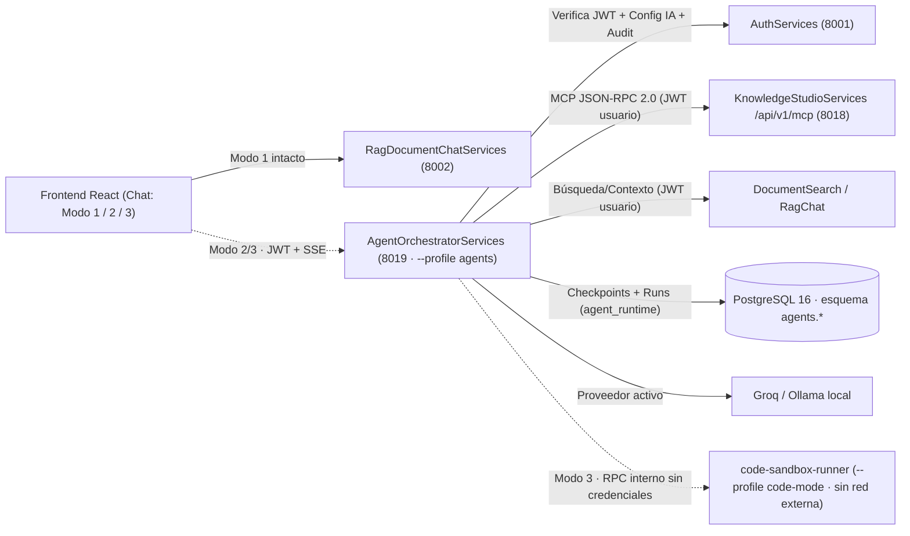

# ROADMAP — Evolución Agentic AI (LangChain, LangGraph y Code Mode)

> **Naturaleza de este documento:** Investigación arquitectónica, diseño técnico y backlog ejecutable para incorporar capacidades agénticas **opcionales, seguras y desacopladas** en Blandskron Documental.  
> **Estado actual:** Backlog `AG-001`..`AG-034` implementado de forma opcional detrás de `AGENTS_ENABLED=false` y `CODE_MODE_ENABLED=false`; el RAG tradicional, Docker Compose base y todos los servicios existentes permanecen intactos.

---

## A. Estado actual verificado

- **Rama de referencia:** `origin/develop`
- **Commit HEAD de referencia:** `5724d48` (`docs: remove obsolete frontend/AUDIT.md and refresh all service, frontend, DB and general docs`)
- **Fecha de investigación:** `2026-11-21`
- **Entorno Python / Node verificado:** Python `3.12` en servicios backend, Node `24` / React `19` / TypeScript estricto en frontend, PostgreSQL `16` + `pgvector` + `pg_trgm`.

### Inventario de componentes reales reutilizables

| Componente | Puerto | Capacidades verificadas en código real | Reutilización directa para Agentic AI |
| --- | ---: | --- | --- |
| [AuthServices](backend/AuthServices/README.md) | 8001 | JWT RS256, `/api/users/me/` (identidad vigente), registro + bootstrap transaccional, Google OIDC opcional, `AuditLog` (`public.audit_logs`), router de proveedor IA (`/api/integrations/ai/provider/`, Groq + Ollama local con allowlist y cifrado `secrets1.`). | Autoridad única de identidad, permisos multiempresa, configuración LLM activa del tenant y auditoría persistente. |
| [RagDocumentChatServices](backend/RagDocumentChatServices/README.md) | 8002 | Recuperación híbrida `pgvector` HNSW + FTS + RRF (`vector_repository_pgvector.py`), anti *prompt-injection* `<document_context>`, citas `[Fuente N]`, SSE (`?stream=true`), `GroqConfigResolver.resolve_active_provider()` + `llm_provider_factory.py` (Groq / OpenAI-compatible / Ollama). | Provee el modo Chat documental intacto y sirve como referencia de resolución dinámica de proveedores LLM por tenant. |
| [RagDocumentEmbeddingServices](backend/RagDocumentEmbeddingServices/README.md) | 8003 | Embeddings locales `intfloat/multilingual-e5-small` (384 dims CPU), chunking estructural (`page`/`section`), idempotencia (`Idempotency-Key` + `content_sha256`), normalizador Markdown y lote ZIP seguro. | Sin cambios; los agentes consumen documentos ya indexados. |
| [DocumentSearchServices](backend/DocumentSearchServices/README.md) | 8004 | Búsqueda FTS `ts_rank_cd` + trigram `filename` con filtros de acceso en servidor. | Fuente autorizada para descubrimiento de documentos por herramienta. |
| [DocumentAccessServices](backend/DocumentAccessServices/README.md) | 8005 | Contenido autorizado, asignaciones, notificaciones, aceptación/rechazo y firma interna. | Consulta de metadatos/estado; acciones de escritura siempre tras aprobación humana explícita. |
| [DocumentExportServices](backend/DocumentExportServices/README.md) | 8016 | Registro extensible de renderers PDF (`chat_snapshot`, `studio_artifact`). | Exportación de informes generados por agentes sin duplicar generación PDF. |
| [KnowledgeStudioServices](backend/KnowledgeStudioServices/README.md) | 8018 *(opcional)* | JWT RS256, esquema `studio.*` con trigger `SECURITY DEFINER` (`FRESH -> STALE`), `StudioQuotaGuard`, `StudioRepositoryPg` (`SKIP LOCKED`), `validate_groundedness`, CSV seguro y servidor MCP JSON-RPC 2.0 en `POST /api/v1/mcp`. | Superficie MCP de solo lectura reutilizable y almacenamiento/validación de artefactos estructurados. |
| [Frontend](frontend/README.md) | 3000 | React 19, `SafeMarkdown` anti-XSS con chips `[Fuente N]`, `/settings/ai` (Groq + Ollama), `/studio`, `/admin/audit`, clientes HTTP por servicio (`session-clients.ts`). | Base para incorporar selección de modo agéntico dentro de la experiencia de Chat sin bifurcar la app. |

### Brechas arquitectónicas verificadas en código

1. **Orquestación multi-paso con estado:** el chat actual (`AskDocumentChat`) es *single-turn* (1 recuperación → 1 llamada LLM). No existe grafo de estados, checkpoints persistentes, suspensión/reanudación ni aprobación humana (*Human-in-the-Loop*).
2. **Paridad de autorización y auditoría en MCP (`KnowledgeStudioServices`):**
   - `POST /api/v1/mcp` (`app/interfaces/mcp_server.py`) valida JWT RS256, pero `ReadOnlyMcpDispatcher` guarda `audit_events` solo en memoria (no persiste en `public.audit_logs`).
   - `search_authorized_documents` en `studio_repository_pg.py` filtra solo por `owner_user_id` y usa `ILIKE` sobre `filename`, sin cubrir documentos compartidos por grupo/asignación activa ni búsqueda FTS.
   - Falta validación estricta de header `Origin` exigida por la especificación Streamable HTTP MCP contra ataques DNS rebinding.
3. **Ejecución aislada de código (Code Mode):** no existe ningún runtime sandboxed para transformar/comparar tablas o datos recuperados programáticamente.
4. **Control de costos agénticos:** `StudioQuotaGuard` existe en memoria en `KnowledgeStudioServices`, pero no hay cuota persistente por ejecución/pasos/tokens/tiempo para grafos multi-paso.

---

## B. Resultados de investigación (contrastados con fuentes oficiales)

> **Fecha de consulta de fuentes oficiales:** `2026-11-21`.

### 1. LangChain

- **Fuentes oficiales:** [docs.langchain.com](https://docs.langchain.com/), [github.com/langchain-ai/langchain](https://github.com/langchain-ai/langchain), [reference.langchain.com](https://reference.langchain.com/).
- **Estado y requisitos:** arquitectura modular desacoplada en paquetes independientes (`langchain-core >= 1.8.x`, `langchain-groq`, `langchain-ollama`, `langchain-mcp-adapters`), licencia **MIT**, requiere **Python >= 3.11** (compatible con nuestro Python 3.12).
- **Qué problemas resuelve realmente en nuestro sistema:**
  - Abstracción uniforme de *tool-calling* (`BaseTool`, `@tool`, esquemas Pydantic/JSON Schema) y mensajes estructurados (`AIMessage`, `ToolMessage`, `with_structured_output`).
  - Puente estándar hacia servidores MCP mediante `langchain-mcp-adapters` (`load_mcp_tools`).
  - Integración directa con `ChatGroq` (`langchain-groq`), `ChatOllama` (`langchain-ollama`) y endpoints OpenAI-compatible (`langchain-openai`), respetando el proveedor activo configurado por el tenant en `tenant_integrations`.
- **Qué resulta REDUNDANTE y NO debe adoptarse:**
  - Retrievers, document loaders, text splitters, vectorstores y embeddings de LangChain: duplicarían nuestra ingesta E5 en CPU, el chunking estructural, los índices HNSW+FTS+RRF y los filtros de autorización SQL multiempresa.
  - El paquete monolítico `langchain` completo (chains heredadas).
- **Recomendación técnica:** **Adopción mínima y estrictamente opcional** — usar únicamente `langchain-core` + `langchain-mcp-adapters` + adaptadores ligeros de chat (`langchain-groq`, `langchain-ollama`, `langchain-openai`) **aislados dentro del servicio opcional de agentes** (nunca en `RagDocumentChatServices` ni en el despliegue base).
- **Alternativa sin LangChain:** implementar manualmente el bucle OpenAI tool-calling + parsers de salida estructurada + adaptador MCP. Ahorra dependencias, pero aumenta el mantenimiento al soportar diferencias de *function calling* entre Groq, Ollama local y modelos OpenAI-compatible.

### 2. LangGraph

- **Fuentes oficiales:** [docs.langchain.com/oss/python/langgraph/overview](https://docs.langchain.com/oss/python/langgraph/overview), [github.com/langchain-ai/langgraph](https://github.com/langchain-ai/langgraph).
- **Estado y requisitos:** `langgraph` + `langgraph-checkpoint-postgres` (`PostgresSaver` / `AsyncPostgresSaver`), licencia **MIT**, usa `psycopg` v3 (ya presente en nuestro stack: `psycopg[binary]==3.2.9`).
- **Viabilidad por capacidad:**
  - **Workflows multi-etapa y estado tipado:** `StateGraph` con estado Pydantic/TypedDict determinista y aristas condicionales.
  - **Persistencia, checkpoints y recuperación ante caídas:** `AsyncPostgresSaver` guarda cada paso en PostgreSQL (puede aislarse en esquema dedicado `agents.*` mediante `search_path` y rol `agent_runtime`, sin nueva BD). Permite reiniciar contenedores sin perder ejecuciones en curso.
  - **Human-in-the-Loop y aprobaciones:** primitiva nativa `interrupt(payload)` que congela el grafo en PostgreSQL y reanuda horas después vía `Command(resume=decision)` sobre el mismo `thread_id`.
  - **Cancelación y límites:** `recursion_limit` nativo + bandera de cancelación verificada entre nodos + presupuesto de tokens/tiempo en el estado del grafo.
  - **Seguridad de serialización:** soporta `LANGGRAPH_STRICT_MSGPACK=true` para mitigar riesgos de deserialización insegura en checkpoints.
- **Recomendación técnica:** **Adoptar LangGraph** como motor de orquestación opcional para el Modo Agente, usando PostgreSQL existente en esquema aislado `agents.*`.

### 3. Cloudflare Code Mode y Sandboxing de ejecución

- **Fuentes oficiales:** [github.com/cloudflare/agents](https://github.com/cloudflare/agents), [developers.cloudflare.com](https://developers.cloudflare.com/), [github.com/cloudflare/workerd](https://github.com/cloudflare/workerd).
- **Qué es y cómo funciona:** Code Mode (paquete `@cloudflare/codemode` dentro de `cloudflare/agents`) reemplaza decenas de llamadas JSON secuenciales a herramientas por un bloque corto de TypeScript/JavaScript generado por el LLM que descubre tipos dinámicamente (`codemode.search()` / `codemode.describe()`) y orquesta herramientas programáticamente a través de RPC, reduciendo drásticamente el consumo de tokens de contexto cuando hay muchas herramientas o transformaciones de datos.
- **Runtime y dependencias verificadas:** usa `DynamicWorkerExecutor` respaldado por el binding `worker_loaders` (`LOADER`) de Cloudflare Workers y `workerd` (licencia Apache 2.0).
- **Compatibilidad con Docker local sin Cloudflare Workers:** puede ejecutarse localmente mediante `wrangler dev` + Miniflare dentro de Docker, pero **introduce limitaciones críticas para nuestro proyecto**:
  1. Añade un runtime Node/TypeScript + `wrangler` + Miniflare paralelo a un backend 100 % Python.
  2. La propia documentación advierte explícitamente que **Miniflare/workerd local no constituye un sandbox de kernel endurecido para código no confiable en producción** sin aislamiento adicional de contenedor/kernel.
  3. El paquete `@cloudflare/codemode` evoluciona con ciclos rápidos y semántica acoplada al ecosistema Workers/AI SDK.
- **Evaluación de alternativas A / B / C:**

| Criterio | A. SDK oficial `@cloudflare/codemode` (`wrangler`/Miniflare en Docker) | B. Runtime propio (patrón Code Mode sobre contenedor endurecido) | C. Motor consolidado de aislamiento (**Deno `--deny-all` / Pyodide WASM** en sidecar endurecido + opción `gVisor`) |
| --- | --- | --- | --- |
| **Aislamiento real** | V8 Isolate (requiere contenedor endurecido extra en local) | Depende de implementación propia (alto riesgo de errores) | **Doble frontera:** V8/WASM sin permisos OS/red + contenedor `--read-only --cap-drop ALL --network none` (y `gVisor`/`runsc` en prod) |
| **Compatibilidad Docker local** | Media (exige Node + `wrangler dev` + binding `LOADER`) | Alta | **Alta** (imagen ligera sin cuenta externa ni Cloudflare Workers) |
| **Alineación con stack Python** | Baja (acoplado a TS/JS AI SDK y Workers RPC) | Alta | **Alta** (invocable por RPC JSON sobre stdin/stdout o socket interno desde Python) |
| **Protección sin `eval`/`exec`/`node:vm`** | Sí (V8 Isolate) | Riesgo si se cae en wrappers débiles | **Sí** (sandbox real V8/WASM + cgroups + seccomp) |
| **Mantenimiento y licencia** | Apache 2.0 / MIT, API en evolución rápida | Alto mantenimiento propio | **MIT / Apache 2.0**, runtimes maduros y estables |

- **Decisión recomendada:** **Enfoque híbrido B+C — Adoptar el patrón arquitectónico Code Mode (descubrimiento progresivo + ejecución programática con RPC tipado hacia el host) sobre un motor consolidado de aislamiento en sidecar (`Deno` con `--deny-all` o `Pyodide`/WASM dentro de contenedor endurecido sin salida a red, con soporte opcional de `gVisor` en producción).** Se **descarta** `eval()`, `exec()`, `node:vm` y la dependencia operativa de Cloudflare Workers/Miniflare.

### 4. MCP (Model Context Protocol) existente

- **Fuentes oficiales:** [modelcontextprotocol.io](https://modelcontextprotocol.io/) (especificación Streamable HTTP 2025/2026).
- **Estado actual verificado en `KnowledgeStudioServices`:**
  - `POST /api/v1/mcp` en [main.py](backend/KnowledgeStudioServices/app/main.py) ya sigue el modelo de endpoint único `POST` JSON-RPC 2.0 con `initialize`, `ping`, `tools/list`, `tools/call`, JWT RS256 obligatorio (`require_studio_user`), 4 herramientas de solo lectura (`search_documents`, `get_document_chunks`, `list_studio_artifacts`, `get_studio_artifact`) y tope `<= 20` resultados.
- **Mejoras puntuales necesarias (sin duplicar servidor ni contratos):**
  1. Validar cabecera `Origin` en `POST /api/v1/mcp` (responder `403` ante orígenes no autorizados para mitigar DNS rebinding).
  2. Persistir los eventos `mcp.*` en `public.audit_logs` (hoy solo viven en memoria en `dispatcher.audit_events`).
  3. Alinear los filtros de autorización de `search_authorized_documents` / `get_authorized_document_chunks` con `VectorRepositoryPgVector` (incluir documentos compartidos por grupo/asignación activa y `TENANT_ADMIN`, y usar FTS en vez de `ILIKE` solo en `filename`).
  4. Soportar respuestas JSON estándar y opcionalmente SSE por petición (Streamable HTTP) manteniendo compatibilidad con clientes actuales.
- **Reutilización desde LangChain, LangGraph y Code Mode:** **Catálogo interno unificado de herramientas** en el orquestador que consume `POST /api/v1/mcp` vía cliente HTTP MCP autenticado propagando el JWT del usuario (y, para búsqueda híbrida semántica, llama a `DocumentSearchServices`/`RagDocumentChatServices` con el mismo JWT). Cero duplicación del servidor MCP.

---

## C. Decisiones arquitectónicas propuestas

### Comparación de 2 alternativas arquitectónicas

#### Alternativa 1 — Extender `KnowledgeStudioServices`
- **Idea:** añadir `langgraph`, `langchain-core`, checkpointer PostgreSQL y endpoints de agentes directamente dentro de `backend/KnowledgeStudioServices/`.
- **Pros:** un contenedor menos en Compose; acceso directo al esquema `studio.*`.
- **Contras:** acopla la generación batch de artefactos (`studio.*`) con orquestación agéntica interactiva/streaming; obliga a instalar `langgraph`/`langchain-*` a quien solo quiere Knowledge Studio; mezcla límites de memoria/concurrencia y roles de base de datos.

#### Alternativa 2 (RECOMENDADA) — Servicio opcional `backend/AgentOrchestratorServices/` + sidecar opcional `code-sandbox-runner`
- **Idea:** nuevo microservicio opcional (puerto `8019`, bandera `AGENTS_ENABLED=false`, perfil Docker Compose `--profile agents`) y sidecar sandbox aislado sin red (`--profile code-mode`, `CODE_MODE_ENABLED=false`, sin puerto publicado al host).
- **Pros:**
  - **Cero impacto en el stack base:** `docker compose up -d --build` no construye ni levanta nada de agentes ni instala dependencias LangChain/LangGraph.
  - **Frontera de seguridad estricta:** `agent_runtime` solo accede al esquema `agents.*` (checkpoints, runs, aprobaciones, cuotas) y **nunca** tiene acceso directo a `public.documents`, archivos originales ni secretos de otros servicios; toda lectura documental pasa por HTTP/MCP propagando el JWT del usuario.
  - **Aislamiento de recursos independiente:** `mem_limit`, `cpus`, `pids_limit` y timeouts dedicados para agentes y para el sandbox de Code Mode.
- **Contras:** un servicio opcional adicional en `docker/compose/agents.yml` (mitigado por estar detrás de `--profile agents`).

### Diagramas Mermaid de las dos alternativas

#### Alternativa 1 (Extensión en KnowledgeStudioServices)


#### Alternativa 2 — Recomendada (`AgentOrchestratorServices` + `code-sandbox-runner`)


### Matriz comparativa de arquitectura

| Dimensión | Alternativa 1 (En Studio) | Alternativa 2 (AgentOrchestratorServices — Recomendada) |
| --- | --- | --- |
| Cohesión y mantenimiento | Media (mezcla batch Studio + grafos agénticos) | **Alta** (frontera hexagonal clara) |
| Aislamiento de permisos BD | Comparte `studio_runtime` | **Dedicado `agent_runtime` solo en `agents.*`** |
| Impacto en Compose base | Ninguno (perfil `studio`) | **Ninguno (perfiles `agents` y `code-mode`)** |
| Riesgo de dependencias | Acopla LangGraph a Studio | **100 % aislado en imagen de agentes** |
| Rollback | Revertir cambios internos en Studio | **Desactivar perfil / `AGENTS_ENABLED=false`** |

### Contratos de entrada/salida propuestos (JSON)

#### 1. Iniciar ejecución de agente (`POST /api/v1/agents/runs`)
```json
{
  "mode": "agent",
  "goal": "Compara las cláusulas de penalización entre los contratos seleccionados y detecta vencimientos.",
  "document_ids": ["doc-001", "doc-002"],
  "enable_code_mode": false,
  "max_steps": 8,
  "max_tokens": 12000,
  "idempotency_key": "run-2026-11-21-001"
}
```

#### 2. Respuesta / Estado de ejecución (`GET /api/v1/agents/runs/{run_id}`)
```json
{
  "run_id": "run_9a8f12",
  "thread_id": "thr_9a8f12",
  "tenant_id": "tenant-1",
  "status": "WAITING_APPROVAL",
  "current_step": "propose_export_artifact",
  "steps": [
    {"index": 1, "tool": "search_documents", "status": "ok", "duration_ms": 142},
    {"index": 2, "tool": "get_document_chunks", "status": "ok", "duration_ms": 98}
  ],
  "pending_approval": {
    "approval_id": "apr_01",
    "action": "save_studio_artifact",
    "summary": "Guardar tabla comparativa en studio.artifacts (2 fuentes verificadas)"
  },
  "sources": [
    {"document_id": "doc-001", "chunk_index": 2, "quote": "penalización del 2% mensual"}
  ],
  "usage": {"prompt_tokens": 2100, "completion_tokens": 640, "steps_used": 2},
  "provider": "ollama"
}
```

#### 3. Aprobación humana (`POST /api/v1/agents/runs/{run_id}/resume`) y Cancelación (`POST /api/v1/agents/runs/{run_id}/cancel`)
```json
{
  "approval_id": "apr_01",
  "decision": "approve",
  "comment": "Verificado por responsable legal."
}
```

### Variables de entorno y recursos mínimos estimados

- `AGENTS_ENABLED=false`, `CODE_MODE_ENABLED=false`
- `AGENT_DB_PASSWORD` (o volumen `runtime_secrets` siguiendo el patrón de `STB-02`)
- `AGENT_MAX_STEPS=10`, `AGENT_MAX_TOKENS_PER_RUN=16000`, `AGENT_RUN_TIMEOUT_SECONDS=120`, `AGENT_DAILY_TOKEN_QUOTA=200000`
- `CODE_SANDBOX_TIMEOUT_MS=5000`, `CODE_SANDBOX_MEMORY_MB=256`, `LANGGRAPH_STRICT_MSGPACK=true`
- **Recursos mínimos adicionales:** `AgentOrchestratorServices` ~256–512 MB RAM / 0.5–1.0 CPU; `code-sandbox-runner` ~256 MB RAM / 0.5 CPU / `pids_limit: 64`.

### Seguridad obligatoria — Matriz de amenazas y mitigaciones

| Amenaza | Mitigación obligatoria |
| --- | --- |
| **Prompt injection en documentos** | Delimitación estricta `<document_context>`, separación de rol sistema/datos y prohibición de ejecutar herramientas de escritura sin `interrupt()` de aprobación humana. |
| **Tool poisoning / MCP malicioso** | Allowlist estática de nombres de herramientas y JSON Schemas validados en el host; solo conectar a servidores MCP internos verificados (sin URLs dinámicas del usuario). |
| **Escalada de privilegios / Cross-tenant** | JWT del usuario propagado en cada llamada; verificación de permisos en cada microservicio destino (no solo en el orquestador); `tenant_id` extraído del JWT/perfil vigente de `AuthServices`. |
| **Acceso a archivos o BD no autorizados** | `agent_runtime` solo tiene permisos en `agents.*`; `code-sandbox-runner` sin montaje de `./documents`, sin `DATABASE_URL` y sin Docker Socket. |
| **Filtración de secretos** | Ninguna API key ni JWT entra al sandbox; el orquestador redacciona patrones de secretos en logs, checkpoints y respuestas. |
| **SSRF** | Reutilización de `validate_provider_base_url` y `validate_ollama_base_url`; `code-sandbox-runner` con salida a red bloqueada (`--deny-net` + red Docker interna aislada). |
| **Ejecución arbitraria de código / Escape** | Sandbox V8/WASM (`Deno --deny-all` o `Pyodide`), contenedor `--read-only`, `--cap-drop ALL`, `no-new-privileges`, sin shell ni `eval`/`exec`/`node:vm`; `gVisor` recomendado en producción. |
| **Consumo descontrolado / Bucles infinitos / Abuso de tokens** | `recursion_limit` en LangGraph, `max_steps`, `max_tokens`, timeout por herramienta y por run, y cuota diaria persistente por tenant/usuario. |
| **Manipulación de resultados / Operaciones destructivas** | Superficie inicial estrictamente de **solo lectura**; toda persistencia (guardar artefacto/exportar) requiere aprobación humana explícita y validación `validate_groundedness`. |
| **Pérdida de trazabilidad** | Cada ejecución, llamada a herramienta, invocación MCP, aprobación y ejecución Code Mode registra eventos en `public.audit_logs` con `run_id`, `tenant_id` y `actor_user_id`. |

### Experiencia de usuario (Frontend — diseño conceptual)

Se recomienda **una experiencia unificada dentro de `ChatPage`** (selector de modo/capacidades en la barra del compositor) en lugar de pantallas duplicadas:
- **Modo 1 — Chat documental (por defecto):** comportamiento actual 100 % intacto (funciona incluso si `AGENTS_ENABLED=false`).
- **Modo 2 — Agente inteligente:** habilitado solo si `AgentOrchestratorServices` reporta `agents_enabled=true`; muestra línea de tiempo colapsable de pasos/herramientas ejecutadas, citas verificables `[Fuente N]`, botón **Cancelar**, tarjetas de **Aprobación humana** cuando el grafo entra en `WAITING_APPROVAL`, y reanudación desde el historial.
- **Modo 3 — Agente avanzado (Code Mode):** toggle opcional sobre el Modo 2 visible solo si `code_mode_enabled=true`; muestra el código ejecutado en sandbox (solo lectura, auditable), salida estructurada/tabla generada y enlace a guardar en Knowledge Studio.

### Mapeo de los 12 casos de uso obligatorios

| # | Caso de uso | Componentes que intervienen | Capacidad nueva requerida |
| --- | --- | --- | --- |
| 1 | Investigar entre varios documentos | `AgentOrchestrator` + `DocumentSearch` + `MCP` + `LLM` | Grafo iterativo multi-consulta con síntesis citada. |
| 2 | Comparar contratos y extraer diferencias | `AgentOrchestrator` + `MCP (get_document_chunks)` + `Code Mode` (opcional) | Nodo comparador estructurado + verificación de citas por cláusula. |
| 3 | Detectar fechas, montos y vencimientos | `AgentOrchestrator` + `MCP` + `Code Mode` (regex/parseo determinista) | Extracción determinista en sandbox + validación de procedencia. |
| 4 | Construir informe con referencias | `AgentOrchestrator` + `KnowledgeStudio` + `DocumentExport` | Adaptador hacia `studio.artifacts` + renderer `studio_artifact`. |
| 5 | Generar tablas comparativas verificadas | `AgentOrchestrator` + `Code Mode` + `Studio (render_evidence_table_csv)` | Validación de celdas contra fragmentos reales sin cifras inventadas. |
| 6 | Workflow con aprobación humana | `AgentOrchestrator (LangGraph interrupt())` + `Frontend` + `AuditLog` | Endpoint `/resume` + tarjeta de confirmación en UI. |
| 7 | Suspender y reanudar investigación | `LangGraph AsyncPostgresSaver (agents.*)` | Checkpointing persistente por `thread_id` + reanudación tras reinicio. |
| 8 | Cancelar tarea en ejecución | `AgentOrchestrator` + `agents.agent_runs` | Endpoint `/cancel` + chequeo cooperativo entre nodos y abort de herramienta. |
| 9 | Procesar con LLM local (Ollama) | `AuthServices (ai_router)` + `AgentOrchestrator` + `Ollama` | Resolver dinámico de proveedor activo compatible con `ChatOllama` + timeouts CPU. |
| 10 | Ejecutar herramientas vía MCP existente | `AgentOrchestrator` → `KnowledgeStudio /api/v1/mcp` | Cliente MCP con propagación JWT + auditoría persistente `mcp.*`. |
| 11 | Transformar datos en sandbox (Code Mode) | `AgentOrchestrator` → `code-sandbox-runner` | RPC interno tipado, límites de CPU/RAM/tiempo, sin red ni secretos. |
| 12 | Recuperarse de herramienta fallida sin duplicar | `LangGraph` + `idempotency_key` en `agents.agent_runs` | Reintento acotado con backoff en herramientas idempotentes de lectura + checkpoint previo. |

### ADRs necesarios y criterios de descarte
- **ADR-006:** Adopción de `AgentOrchestratorServices` con LangGraph + esquema `agents.*` y uso mínimo de `langchain-core`.
- **ADR-007:** Arquitectura de Code Mode en sandbox local endurecido (Deno/WASM) y exclusión de `wrangler`/Miniflare y `eval`/`exec`.
- **Criterios de descarte (kill-switches):** descartar Code Mode si no supera pruebas de aislamiento sin escape de red/FS; descartar uso de LangChain si el soporte de *tool-calling* con modelos pequeños de Ollama (`3b`) resulta más confiable vía prompt estructurado directo.

---

## D. Backlog técnico priorizado (Épicas y Tareas)

> **Convención de estados:** `[ ]` Pendiente · `[~]` En progreso · `[x]` Completada · `[!]` Bloqueada.  
> **Complejidad:** `S` (<0.5 día) · `M` (0.5–1.5 días) · `L` (2–3 días) · `XL` (3–5 días).

### Épica E0 — Decisiones arquitectónicas y endurecimiento de base (Fase 0)

- **`AG-001` — Redactar ADR-006 (LangGraph + AgentOrchestratorServices) y ADR-007 (Code Mode Sandbox)**
  - **Estado:** `[x]` | **Prioridad:** P0 | **Complejidad:** S | **Dependencias:** Ninguna
  - **Objetivo:** Formalizar las fronteras de responsabilidad, esquema `agents.*`, uso mínimo de `langchain-core` y política de sandbox antes de escribir código.
  - **Descripción técnica:** Crear `docs/ADR_AGENT_ORCHESTRATOR.md` y `docs/ADR_CODE_MODE_SANDBOX.md` con contratos, límites y criterios de descarte.
  - **Archivos/servicios:** `docs/ADR_AGENT_ORCHESTRATOR.md`, `docs/ADR_CODE_MODE_SANDBOX.md`, `docs/maintainers.md`.
  - **Contratos:** Ninguno público.
  - **Pruebas:** `python3 scripts/ci/check_docs_links.py`.
  - **Criterios de aceptación:** Ambos ADRs aprobados, enlazados en `docs/maintainers.md` y con 0 enlaces rotos.
  - **Riesgos:** Deriva arquitectónica si se empieza a codificar antes de acordar límites.

- **`AG-002` — Endurecer el servidor MCP existente (`Origin`, paridad de permisos y auditoría persistente)**
  - **Estado:** `[x]` | **Prioridad:** P0 | **Complejidad:** M | **Dependencias:** `AG-001`
  - **Objetivo:** Dejar `POST /api/v1/mcp` listo para ser consumido por agentes y clientes MCP modernos sin brechas de seguridad ni de permisos.
  - **Descripción técnica:** Validar header `Origin` contra `CORS_ORIGINS` (403 ante orígenes inválidos); persistir eventos `mcp.*` en `public.audit_logs` (o vía endpoint interno/rol append-only); alinear `search_authorized_documents` y `get_authorized_document_chunks` con FTS y permisos de grupo/asignación activa/tenant admin.
  - **Archivos/servicios:** `backend/KnowledgeStudioServices/app/interfaces/mcp_server.py`, `app/infrastructure/studio_repository_pg.py`, `scripts/database/studio/provision_role.sql`, `tests/test_mcp_jsonrpc_server.py`.
  - **Contratos:** `POST /api/v1/mcp` (JSON-RPC 2.0, retrocompatible).
  - **Pruebas:** Tests unitarios/HTTP de `Origin` inválido (403), aislamiento multiempresa, acceso por grupo/asignación y persistencia en `audit_logs`.
  - **Criterios de aceptación:** 100 % de pruebas MCP en verde; eventos `mcp.*` visibles en `/admin/audit` sin exponer fragmentos privados.
  - **Riesgos:** Regresión de permisos en `studio_runtime` (mitigar con `verify_role.sql`).

### Épica E1 — Esquema `agents.*`, rol de mínimos privilegios y catálogo de herramientas (Fase 1)

- **`AG-003` — Crear esquema SQL aislado `agents.*` y rol PostgreSQL `agent_runtime`**
  - **Estado:** `[x]` | **Prioridad:** P0 | **Complejidad:** M | **Dependencias:** `AG-001`
  - **Objetivo:** Persistir ejecuciones, aprobaciones, cuotas y checkpoints de LangGraph en PostgreSQL existente con aislamiento total respecto a `public.documents`.
  - **Descripción técnica:** Añadir `scripts/database/schemas/014_agent_orchestrator.sql` (`agents.agent_runs`, `agents.agent_approvals`, `agents.agent_usage_daily` + soporte para tablas de checkpoints de LangGraph) y `scripts/database/agents/{provision_role.sql,verify_role.sql}` otorgando a `agent_runtime` privilegios únicamente en `agents.*` y lectura mínima de `tenant_integrations` (o vía AuthServices).
  - **Archivos/servicios:** `scripts/database/schemas/014_agent_orchestrator.sql`, `scripts/database/run_all.sql`, `scripts/database/agents/*`, `scripts/database/tests/agents_schema_integrity.sql`.
  - **Contratos:** Esquema PostgreSQL aditivo (cero cambios destructivos en `public.*`).
  - **Pruebas:** Suite SQL en `postgres-upgrade` verificando que `agent_runtime` no puede leer ni modificar `public.documents` ni `auth_user`.
  - **Criterios de aceptación:** Migración idempotente en arranque y segundo arranque; test SQL de aislamiento en verde.
  - **Riesgos:** Conflicto de privilegios en `pg_dump`/restauración (validar con `verify_postgres_upgrade.mjs`).

- **`AG-004` — Crear estructura base de `AgentOrchestratorServices` y overlay `docker/compose/agents.yml`**
  - **Estado:** `[x]` | **Prioridad:** P0 | **Complejidad:** M | **Dependencias:** `AG-003`
  - **Objetivo:** Levantar el esqueleto hexagonal del servicio opcional (`AGENTS_ENABLED=false`, puerto `8019`, perfil `--profile agents`) sin afectar el stack base.
  - **Descripción técnica:** Crear `backend/AgentOrchestratorServices/` (`Dockerfile` non-root sin `pip`, `requirements.txt` pineado, `app/config/security.py` con JWT RS256 + `/api/users/me/`, `app/main.py` con `/api/v1/health` y gate `503` cuando `AGENTS_ENABLED=false`), y `docker/compose/agents.yml`.
  - **Archivos/servicios:** `backend/AgentOrchestratorServices/*`, `docker/compose/agents.yml`, `scripts/ci/detect_changes.py`.
  - **Contratos:** `GET /api/v1/health` (`{"status":"ok","agents_enabled":bool,"code_mode_enabled":bool}`).
  - **Pruebas:** `docker compose config --quiet` (base intacto + overlay `agents.yml`), test HTTP 503 con `AGENTS_ENABLED=false` y 401 sin JWT.
  - **Criterios de aceptación:** `docker compose up` base no construye ni arranca agentes; overlay `--profile agents` pasa contrato Compose.
  - **Riesgos:** Romper aserciones de `compose-contract` en `ci-fast.yml` (mantener overlay separado).

- **`AG-005` — Implementar catálogo interno de herramientas y cliente MCP con propagación JWT**
  - **Estado:** `[x]` | **Prioridad:** P0 | **Complejidad:** M | **Dependencias:** `AG-002`, `AG-004`
  - **Objetivo:** Centralizar las herramientas autorizadas de solo lectura reutilizando `POST /api/v1/mcp` y las APIs documentales existentes.
  - **Descripción técnica:** Implementar `ToolRegistry` con política de capacidades explícita (`read_only=True`, timeout, tope de resultados, esquema Pydantic) y `McpClientAdapter` que propaga el `Authorization: Bearer <user_jwt>` hacia `KnowledgeStudioServices` y `DocumentSearchServices`.
  - **Archivos/servicios:** `backend/AgentOrchestratorServices/app/application/tools/registry.py`, `app/infrastructure/mcp/mcp_client.py`, `tests/test_tool_registry.py`.
  - **Contratos:** Invocación JSON-RPC 2.0 hacia `POST /api/v1/mcp` y `GET /api/v1/documents/search`.
  - **Pruebas:** Tests con transporte HTTP simulado verificando propagación de JWT, rechazo de herramientas fuera de allowlist, timeouts y redacción de secretos en logs.
  - **Criterios de aceptación:** Las 4 herramientas MCP y búsqueda documental operan bajo un único registro tipado sin duplicar lógica de autorización.
  - **Riesgos:** Fuga de JWT en trazas de error (mitigar con sanitizador dedicado).

### Épica E2 — Adaptador LLM opcional (`langchain-core`) y Orquestador LangGraph (Fases 2 y 3)

- **`AG-006` — Integrar adaptador LLM `langchain-core` reutilizando el router Groq / Ollama del tenant**
  - **Estado:** `[x]` | **Prioridad:** P1 | **Complejidad:** M | **Dependencias:** `AG-005`
  - **Objetivo:** Permitir que el agente use automáticamente el proveedor activo del tenant (Groq, Ollama local o OpenAI-compatible) con *tool-calling* tipado y fallback estructurado para modelos CPU pequeños.
  - **Descripción técnica:** Resolver configuración activa del tenant (reutilizando la misma lógica `ai_router` + `SecretsCipher` `secrets1.` + `validate_provider_base_url`), instanciar `ChatGroq` / `ChatOllama` / `ChatOpenAI` con timeouts y `max_tokens` acotados, e implementar un modo de fallback JSON estructurado cuando un modelo Ollama local no soporte *native tool calling* de forma confiable.
  - **Archivos/servicios:** `backend/AgentOrchestratorServices/app/infrastructure/llm/model_factory.py`, `tests/test_model_factory.py`.
  - **Contratos:** Lectura compatible con `tenant_integrations` (`ai_router`, `groq`, `ollama`).
  - **Pruebas:** Tests unitarios con mocks de Groq y Ollama (incluyendo degradación honesta `not_configured` / `provider_error` y SSRF bloqueado).
  - **Criterios de aceptación:** Cambio de Groq ↔ Ollama en `/settings/ai` surte efecto en nuevas ejecuciones de agentes sin reiniciar contenedores.
  - **Riesgos:** Modelos Ollama 2B/3B con *tool-calling* inconsistente (mitigado por el fallback JSON estructurado).

- **`AG-007` — Implementar grafo principal de investigación documental con LangGraph (`StateGraph`)**
  - **Estado:** `[x]` | **Prioridad:** P1 | **Complejidad:** L | **Dependencias:** `AG-006`
  - **Objetivo:** Orquestar consultas multi-paso (investigación multi-documento, comparación de contratos, extracción de fechas/montos/vencimientos) con citas verificables.
  - **Descripción técnica:** Definir `AgentState` tipado (`messages`, `document_ids`, `evidence`, `steps`, `token_budget`, `cancelled`) y nodos `plan → retrieve_tools → synthesize → verify_citations` con `recursion_limit`, reintentos acotados en fallos transitorios de lectura e idempotencia por `idempotency_key`.
  - **Archivos/servicios:** `backend/AgentOrchestratorServices/app/application/graph/research_graph.py`, `app/interfaces/api/v1/runs_routes.py`, `tests/test_research_graph.py`.
  - **Contratos:** `POST /api/v1/agents/runs`, `GET /api/v1/agents/runs/{run_id}`, `GET /api/v1/agents/runs/{run_id}/stream` (SSE).
  - **Pruebas:** Tests de los casos de uso 1, 2, 3, 9, 10 y 12 (incluyendo fallo de herramienta sin duplicación y límite de pasos).
  - **Criterios de aceptación:** Respuestas incluyen `sources` verificables, respetan `max_steps`/`max_tokens` y no alucinan citas fuera de fragmentos recuperados.
  - **Riesgos:** Bucles de razonamiento en modelos pequeños (mitigado con `recursion_limit` y detección de llamadas repetidas).

### Épica E3 — Persistencia, Checkpoints, Cancelación y Human-in-the-Loop (Fase 4)

- **`AG-008` — Integrar `AsyncPostgresSaver` (`LANGGRAPH_STRICT_MSGPACK=true`) y recuperación ante reinicios**
  - **Estado:** `[x]` | **Prioridad:** P1 | **Complejidad:** M | **Dependencias:** `AG-003`, `AG-007`
  - **Objetivo:** Persistir cada paso del grafo en `agents.*` permitiendo suspender y reanudar investigaciones incluso tras reiniciar contenedores.
  - **Descripción técnica:** Configurar `AsyncPostgresSaver` sobre el esquema `agents` con `LANGGRAPH_STRICT_MSGPACK=true`, tabla `agents.agent_runs` sincronizada con `thread_id` y aislamiento estricto por `(tenant_id, user_id)`.
  - **Archivos/servicios:** `backend/AgentOrchestratorServices/app/infrastructure/database/checkpointer.py`, `app/infrastructure/database/runs_repository.py`, `tests/test_checkpoints_and_recovery.py`.
  - **Contratos:** `GET /api/v1/agents/runs` (historial propio del usuario).
  - **Pruebas:** Test de integración re-instanciando el grafo desde cero sobre el mismo `thread_id` y verificando aislamiento cross-tenant.
  - **Criterios de aceptación:** Una ejecución suspendida se reanuda exactamente en el nodo guardado tras reinicio; otro usuario/tenant recibe 404.
  - **Riesgos:** Tamaño excesivo de checkpoints si se guardan documentos completos (guardar solo referencias `document_id#chunk_index` y extractos acotados).

- **`AG-009` — Implementar `interrupt()` Human-in-the-Loop, cancelación cooperativa y cuotas por tenant**
  - **Estado:** `[x]` | **Prioridad:** P1 | **Complejidad:** M | **Dependencias:** `AG-008`
  - **Objetivo:** Exigir aprobación humana antes de persistir artefactos/exportaciones, permitir cancelar ejecuciones activas y limitar consumo diario por empresa.
  - **Descripción técnica:** Nodo `human_approval` usando `langgraph.types.interrupt(...)` + `Command(resume=...)` en `POST /api/v1/agents/runs/{run_id}/resume`; cancelación vía `POST /api/v1/agents/runs/{run_id}/cancel` verificada antes de cada nodo/herramienta; control de cuotas persistente en `agents.agent_usage_daily` + registro en `public.audit_logs`.
  - **Archivos/servicios:** `backend/AgentOrchestratorServices/app/application/graph/approval_node.py`, `app/application/quota_service.py`, `tests/test_hitl_cancel_quota.py`.
  - **Contratos:** `POST /api/v1/agents/runs/{run_id}/resume`, `POST /api/v1/agents/runs/{run_id}/cancel`.
  - **Pruebas:** Tests de aprobación, rechazo, cancelación en vuelo (casos de uso 6, 7 y 8) y rechazo `429` al agotar cuota diaria.
  - **Criterios de aceptación:** Ninguna acción de guardado se ejecuta sin decisión explícita `"approve"` del propietario; cancelar detiene nuevos pasos y libera concurrencia.
  - **Riesgos:** Doble reanudación concurrente (mitigar con `SELECT ... FOR UPDATE` sobre `agents.agent_runs`).

### Épica E4 — Code Mode seguro en sandbox aislado (Fase 5)

- **`AG-010` — Construir sidecar `code-sandbox-runner` endurecido (Deno `--deny-all` / WASM sin red externa)**
  - **Estado:** `[x]` | **Prioridad:** P2 | **Complejidad:** L | **Dependencias:** `AG-004`
  - **Objetivo:** Proveer un entorno de ejecución verdaderamente aislado para transformar/comparar datos recuperados sin `eval`/`exec`/`node:vm` ni dependencia de Cloudflare Workers.
  - **Descripción técnica:** Contenedor minimalista (`--read-only`, `--cap-drop ALL`, `no-new-privileges`, `mem_limit: 256m`, `cpus: 0.5`, `pids_limit: 64`, sin puerto en host, red interna aislada sin salida a internet) que ejecuta scripts JS/TS en `Deno` con `--deny-all` (o runtime WASM) con timeout estricto (`5s`) y canal RPC tipado únicamente hacia herramientas de solo lectura expuestas por el host.
  - **Archivos/servicios:** `backend/CodeSandboxRunner/` (`Dockerfile`, runner Deno/WASM), `docker/compose/code-mode.yml`, `tests/test_sandbox_escape.py`.
  - **Contratos:** RPC interno `POST /execute` (solo red interna, jamás expuesto en `127.0.0.1` ni internet).
  - **Pruebas:** Batería adversarial obligatoria: intento de `fetch()` externo, lectura de `/etc/passwd` o `env`, bucle infinito (corte por timeout), bomba de memoria (OOM acotado sin afectar al host), intento de acceso a PostgreSQL/Auth.
  - **Criterios de aceptación:** 100 % de intentos de escape/red/FS bloqueados; transformaciones válidas (tablas, sumas, diffs de fechas/montos) completan en `<2s`.
  - **Riesgos:** Vulnerabilidad zero-day en motor V8 (documentar opción `runtime: runsc` / gVisor para despliegues multi-tenant de producción).

- **`AG-011` — Integrar nodo opcional Code Mode en LangGraph con descubrimiento progresivo de herramientas**
  - **Estado:** `[x]` | **Prioridad:** P2 | **Complejidad:** M | **Dependencias:** `AG-007`, `AG-010`
  - **Objetivo:** Permitir que el agente use Code Mode (solo cuando `CODE_MODE_ENABLED=true` y el usuario activa Modo 3) para cálculos, comparativas y tablas deterministas (casos de uso 4, 5 y 11).
  - **Descripción técnica:** Exponer al modelo la descripción compacta de tipos de las herramientas de solo lectura (`search`, `describe`, `execute_code`), validar sintaxis/tamaño del script antes de enviarlo al sidecar, registrar código y resultado en auditoría y validar citas resultantes con `validate_groundedness`.
  - **Archivos/servicios:** `backend/AgentOrchestratorServices/app/application/graph/code_mode_node.py`, `app/infrastructure/sandbox/sandbox_client.py`, `tests/test_code_mode_integration.py`.
  - **Contratos:** Campo `enable_code_mode: true` en `POST /api/v1/agents/runs` (devuelve `503 CODE_MODE_DISABLED` si el perfil no está activo).
  - **Pruebas:** Tests end-to-end simulados de tabla comparativa, cálculo de vencimientos y bloqueo cuando `CODE_MODE_ENABLED=false`.
  - **Criterios de aceptación:** El código generado nunca recibe tokens ni credenciales; los resultados numéricos provienen exclusivamente de datos recuperados verificables.
  - **Riesgos:** Aumento de latencia en modelos locales pequeños (mantener desactivado por defecto en Modo 1 y 2).

### Épica E5 — Integración con Knowledge Studio, Frontend unificado y Hardening final (Fases 6, 7 y 8)

- **`AG-012` — Conectar salidas aprobadas del agente con Knowledge Studio y DocumentExportServices**
  - **Estado:** `[x]` | **Prioridad:** P2 | **Complejidad:** M | **Dependencias:** `AG-009`
  - **Objetivo:** Guardar informes y tablas aprobadas por el humano como artefactos versionados en `studio.artifacts` y exportables a PDF/CSV.
  - **Descripción técnica:** Adaptador HTTP autenticado con el JWT del usuario hacia `POST /api/v1/studio/artifacts` y `DocumentExportServices` (`studio_artifact`), ejecutado únicamente tras aprobación humana en `AG-009`.
  - **Archivos/servicios:** `backend/AgentOrchestratorServices/app/infrastructure/studio/studio_client.py`, `tests/test_studio_handoff.py`.
  - **Contratos:** `POST /api/v1/studio/artifacts`.
  - **Pruebas:** Test de guardado tras aprobación, verificación de `groundedness` y degradación limpia si `--profile studio` no está activo.
  - **Criterios de aceptación:** Los informes aprobados aparecen en `/studio` con estado `FRESH` y enlace a fuentes reales.
  - **Riesgos:** Studio deshabilitado (ofrecer descarga directa Markdown/CSV como alternativa limpia).

- **`AG-013` — Integrar selector unificado de modos (Chat / Agente / Agente+Code Mode) en Frontend**
  - **Estado:** `[x]` | **Prioridad:** P2 | **Complejidad:** L | **Dependencias:** `AG-009`, `AG-011`
  - **Objetivo:** Exponer la experiencia agéntica dentro de `ChatPage` sin alterar el Modo 1 ni requerir pantallas duplicadas.
  - **Descripción técnica:** Añadir `VITE_AGENT_ORCHESTRATOR_BASE_URL` (opcional), cliente `agentClient` en `session-clients.ts`, selector de modo en `ChatComposer` (oculto o deshabilitado con explicación si `AGENTS_ENABLED=false`), panel colapsable de pasos/herramientas en tiempo real vía SSE, tarjetas de aprobación humana (`/resume`), botón cancelar (`/cancel`) y visor de código ejecutado en Modo 3 usando `SafeMarkdown`.
  - **Archivos/servicios:** `frontend/src/features/agents/*`, `frontend/src/pages/ChatPage/ChatPage.tsx`, `frontend/src/app/config/env.ts`, `frontend/tests/agents.api.test.js`, `frontend/tests/browser/`.
  - **Contratos:** Consumo de `/api/v1/agents/runs*`.
  - **Pruebas:** `npm run lint`, `typecheck`, `format:check`, `npm test`, `npm run build` y Playwright (incluyendo `axe` accesibilidad y regresión de Modo 1).
  - **Criterios de aceptación:** Con agentes deshabilitados, la UI funciona 100 % igual que hoy; con agentes habilitados, el usuario completa un flujo con pasos, aprobación y cancelación.
  - **Riesgos:** Ruido visual en el chat simple (mantener detalles de ejecución colapsados por defecto).

- **`AG-014` — Suite de seguridad, regresión, límites de rendimiento y documentación operativa**
  - **Estado:** `[x]` | **Prioridad:** P1 | **Complejidad:** M | **Dependencias:** `AG-012`, `AG-013`
  - **Objetivo:** Validar todos los quality gates antes de integrar la capacidad agéntica en `develop` / `main`.
  - **Descripción técnica:** Añadir job selectivo `agents-fast` en `.github/workflows/ci-fast.yml` (sin ralentizar PRs que no toquen agentes), pruebas de regresión RAG tradicional, benchmark de RAM/CPU/latencia con Groq y Ollama local, y documentación de perfiles `--profile agents` y `--profile code-mode` en `README.md`, `docs/operations.md` y `docs/architecture.md`.
  - **Archivos/servicios:** `.github/workflows/ci-fast.yml`, `scripts/ci/detect_changes.py`, `README.md`, `docs/operations.md`, `docs/architecture.md`.
  - **Contratos:** CI selectivo `ci-fast-gate` y `ci-integration-gate`.
  - **Pruebas:** Suite completa de regresión + Trivy sobre nuevas imágenes + `check_docs_links.py`.
  - **Criterios de aceptación:** Todos los quality gates en verde; 0 vulnerabilidades críticas/altas sin mitigación; arranque base sin cambios.
  - **Riesgos:** Incremento de tiempo en CI (mitigado por detección selectiva de cambios).

### Épica E6 — Endurecimiento productivo, observabilidad, SSE real y plantillas especializadas

- **`AG-015` — Integración directa de `DocumentSearchServices` (`search_documents_fts`) en `ToolRegistry`**
  - **Estado:** `[x]` | **Prioridad:** P1 | **Complejidad:** S | **Dependencias:** `AG-005`
  - **Objetivo:** Permitir descubrimiento híbrido FTS/trigram con propagación JWT directo hacia `DocumentSearchServices` incluso si Knowledge Studio está apagado.
  - **Archivos/servicios:** `backend/AgentOrchestratorServices/app/infrastructure/search/search_client.py`, `tests/test_search_tool_adapter.py`.

- **`AG-016` — Plantillas especializadas de investigación documental y extracción determinista de fechas/montos**
  - **Estado:** `[x]` | **Prioridad:** P1 | **Complejidad:** M | **Dependencias:** `AG-007`
  - **Objetivo:** Exponer 4 plantillas (`research_general`, `contract_comparison`, `dates_amounts_extraction`, `executive_report_studio`) en `GET /api/v1/agents/templates` con extracción determinista de fechas/montos/porcentajes.
  - **Archivos/servicios:** `backend/AgentOrchestratorServices/app/application/templates/agent_templates.py`, `tests/test_agent_templates.py`.

- **`AG-017` — Validación activa de identidad vigente contra `AuthServices /api/users/me/` con caché corta**
  - **Estado:** `[x]` | **Prioridad:** P0 | **Complejidad:** M | **Dependencias:** `AG-004`
  - **Objetivo:** Fallar cerrado (`401`/`403` ante cuentas deshabilitadas o tokens revocados; `503` si AuthServices no responde) con caché de 10 s.
  - **Archivos/servicios:** `backend/AgentOrchestratorServices/app/config/identity_verifier.py`, `app/config/security.py`, `tests/test_identity_verification.py`.

- **`AG-018` — Endpoints de descubrimiento progresivo de herramientas (`tools/search`, `tools/{tool_name}`) y validación de argumentos requeridos**
  - **Estado:** `[x]` | **Prioridad:** P1 | **Complejidad:** S | **Dependencias:** `AG-011`
  - **Objetivo:** Exponer descubrimiento progresivo solo de herramientas `read_only=True` y rechazar argumentos requeridos faltantes antes de invocar handlers.
  - **Archivos/servicios:** `backend/AgentOrchestratorServices/app/main.py`, `app/application/tools/registry.py`, `tests/test_progressive_discovery_api.py`.

- **`AG-019` — Métricas operativas y telemetría local por tenant (`/api/v1/agents/metrics` y `/api/v1/agents/quota`)**
  - **Estado:** `[x]` | **Prioridad:** P2 | **Complejidad:** S | **Dependencias:** `AG-009`
  - **Objetivo:** Visibilizar consumo diario frente a cuota y métricas no sensibles (estados, proveedores, Code Mode, latencia media) aisladas por tenant.
  - **Archivos/servicios:** `backend/AgentOrchestratorServices/app/application/metrics_service.py`, `app/interfaces/api/v1/runs_routes.py`, `tests/test_metrics_and_quota_api.py`.

- **`AG-020` — Exportación directa Markdown y CSV anti-inyección de fórmulas (`GET /api/v1/agents/runs/{run_id}/export`)**
  - **Estado:** `[x]` | **Prioridad:** P2 | **Complejidad:** S | **Dependencias:** `AG-007`
  - **Objetivo:** Permitir descargar resultados citados en `.md` o `.csv` seguro neutralizando fórmulas (`=`, `+`, `-`, `@`).
  - **Archivos/servicios:** `backend/AgentOrchestratorServices/app/application/export_service.py`, `tests/test_run_export.py`.

- **`AG-021` — Verificación SQL ampliada de `agents.agent_checkpoints` y cableado completo de entorno en `agents.yml`**
  - **Estado:** `[x]` | **Prioridad:** P1 | **Complejidad:** S | **Dependencias:** `AG-008`, `AG-017`
  - **Objetivo:** Validar en SQL la tabla `agents.agent_checkpoints` y privilegios `agent_runtime`, y cablear `AUTH_IDENTITY_URL`, `KNOWLEDGE_STUDIO_BASE_URL` y cuotas en `docker/compose/agents.yml`.
  - **Archivos/servicios:** `scripts/database/tests/agents_schema_integrity.sql`, `scripts/database/agents/verify_role.sql`, `docker/compose/agents.yml`.

- **`AG-022` — Historial de ejecuciones, selector de plantillas, indicador de cuota y descarga MD/CSV en Frontend**
  - **Estado:** `[x]` | **Prioridad:** P2 | **Complejidad:** M | **Dependencias:** `AG-013`, `AG-016`, `AG-019`, `AG-020`
  - **Objetivo:** Integrar historial colapsable (`AgentHistoryList`), selector de plantillas en `AgentModeSelector`, indicador de cuota y botones MD/CSV en `AgentRunPanel` sin alterar Modo 1.
  - **Archivos/servicios:** `frontend/src/features/agents/components/AgentHistoryList.tsx`, `AgentModeSelector.tsx`, `AgentRunPanel.tsx`, `frontend/src/pages/ChatPage/ChatPage.tsx`.

- **`AG-023` — Cliente SSE en tiempo real con cabecera `Authorization: Bearer` y pruebas unitarias**
  - **Estado:** `[x]` | **Prioridad:** P2 | **Complejidad:** S | **Dependencias:** `AG-013`
  - **Objetivo:** Consumir `GET /api/v1/agents/runs/{run_id}/stream` vía `fetch` + `ReadableStream` con soporte de `AbortSignal` y parser SSE incremental.
  - **Archivos/servicios:** `frontend/src/features/agents/api/agents.stream.ts`, `frontend/tests/agents.stream.test.js`.

- **`AG-024` — Benchmark determinista de presupuesto de rendimiento agéntico y atajos en `Makefile`**
  - **Estado:** `[x]` | **Prioridad:** P2 | **Complejidad:** S | **Dependencias:** `AG-014`
  - **Objetivo:** Medir latencias de compactación de checkpoints, verificación de citas, extracción determinista y validación de sandbox sin API keys externas, y exponer `make test-agents` / `make benchmark-agents`.
  - **Archivos/servicios:** `scripts/eval/benchmark_agents_budget.py`, `Makefile`.

### Épica E7 — Capacidades documentales avanzadas, resiliencia operativa, exportación PDF y cobertura UI

- **`AG-025` — Adaptador de solo lectura hacia `DocumentAccessServices` (`get_document_metadata`) en `ToolRegistry`**
  - **Estado:** `[x]` | **Prioridad:** P1 | **Complejidad:** S | **Dependencias:** `AG-015`
  - **Objetivo:** Permitir inspección de metadatos autorizados de documentos vía `DocumentAccessServices` propagando el JWT del usuario.
  - **Archivos/servicios:** `backend/AgentOrchestratorServices/app/infrastructure/access/access_client.py`, `tests/test_access_tool_adapter.py`.

- **`AG-026` — Motor determinista de comparación de contratos (`compare_contract_clauses`)**
  - **Estado:** `[x]` | **Prioridad:** P1 | **Complejidad:** M | **Dependencias:** `AG-016`
  - **Objetivo:** Agrupar evidencia verificada por documento, detectar cláusulas (penalización, vigencia, monto, rescisión, confidencialidad), señalar diferencias y generar tabla comparativa citada `[Fuente N]`.
  - **Archivos/servicios:** `backend/AgentOrchestratorServices/app/application/analysis/contract_comparator.py`, `tests/test_contract_comparator.py`.

- **`AG-027` — Detector determinista de vencimientos y alertas de calendario (`detect_expirations`)**
  - **Estado:** `[x]` | **Prioridad:** P1 | **Complejidad:** S | **Dependencias:** `AG-016`
  - **Objetivo:** Clasificar fechas extraídas en buckets de urgencia (`EXPIRED`, `URGENT_30D`, `UPCOMING_90D`, `FUTURE`) con anclaje a `document_id#chunk_index`.
  - **Archivos/servicios:** `backend/AgentOrchestratorServices/app/application/analysis/expiration_detector.py`, `tests/test_expiration_detector.py`.

- **`AG-028` — Endpoint de análisis determinista rápido (`POST /api/v1/agents/runs/{run_id}/analyze`)**
  - **Estado:** `[x]` | **Prioridad:** P1 | **Complejidad:** S | **Dependencias:** `AG-026`, `AG-027`
  - **Objetivo:** Ejecutar comparación de cláusulas, detección de vencimientos y extracción de hechos sobre fuentes verificadas con coste cero de LLM.
  - **Archivos/servicios:** `backend/AgentOrchestratorServices/app/interfaces/api/v1/runs_routes.py`.

- **`AG-029` — Handoff directo a `DocumentExportServices` para generar PDF de una ejecución (`POST /api/v1/agents/runs/{run_id}/export-pdf`)**
  - **Estado:** `[x]` | **Prioridad:** P2 | **Complejidad:** S | **Dependencias:** `AG-020`
  - **Objetivo:** Exportar informes agénticos a PDF con idempotencia propagando el JWT del usuario y degradación limpia a Markdown si el servicio de exportación está apagado.
  - **Archivos/servicios:** `backend/AgentOrchestratorServices/app/infrastructure/export/pdf_export_client.py`, `tests/test_pdf_export_client.py`.

- **`AG-030` — Rate limiter deslizante por `(tenant_id, user_id)` (`AgentRateLimiter`) con cabecera `Retry-After`**
  - **Estado:** `[x]` | **Prioridad:** P1 | **Complejidad:** S | **Dependencias:** `AG-009`
  - **Objetivo:** Mitigar ráfagas accidentales en `POST /api/v1/agents/runs` devolviendo HTTP `429` con `Retry-After`.
  - **Archivos/servicios:** `backend/AgentOrchestratorServices/app/application/rate_limiter.py`, `tests/test_rate_limiter.py`.

- **`AG-031` — Inspección de metadatos y retención/poda de checkpoints (`prune_old_checkpoints`, `GET /runs/{run_id}/checkpoints`)**
  - **Estado:** `[x]` | **Prioridad:** P2 | **Complejidad:** S | **Dependencias:** `AG-008`
  - **Objetivo:** Evitar crecimiento ilimitado de `agents.agent_checkpoints` y exponer metadatos seguros de progreso sin filtrar secretos.
  - **Archivos/servicios:** `backend/AgentOrchestratorServices/app/infrastructure/database/checkpointer.py`, `tests/test_checkpoint_retention.py`.

- **`AG-032` — Filtros en `AgentHistoryList`, panel de análisis determinista (fechas/montos) y botón PDF en Frontend**
  - **Estado:** `[x]` | **Prioridad:** P2 | **Complejidad:** M | **Dependencias:** `AG-022`, `AG-028`, `AG-029`
  - **Objetivo:** Permitir filtrar ejecuciones por estado/objetivo, lanzar análisis determinista de fechas/montos y exportar a PDF desde `AgentRunPanel`.
  - **Archivos/servicios:** `frontend/src/features/agents/components/AgentHistoryList.tsx`, `AgentRunPanel.tsx`, `frontend/src/pages/ChatPage/ChatPage.tsx`.

- **`AG-033` — Pruebas unitarias de renderizado y accesibilidad de componentes React de Agentes**
  - **Estado:** `[x]` | **Prioridad:** P1 | **Complejidad:** S | **Dependencias:** `AG-032`
  - **Objetivo:** Verificar en CI que `AgentModeSelector` no altera Modo 1 cuando `agents_enabled=false` y que `AgentRunPanel`/`AgentHistoryList` renderizan controles accesibles cuando están activos.
  - **Archivos/servicios:** `frontend/tests/agents.components.test.js`.

- **`AG-034` — Validador de contrato de seguridad en CI (`check_agents_contract.py`) y documentación completa de endpoints**
  - **Estado:** `[x]` | **Prioridad:** P1 | **Complejidad:** S | **Dependencias:** `AG-025`..`AG-033`
  - **Objetivo:** Blindar en `agents-fast` que `AGENTS_ENABLED=false`, `CODE_MODE_ENABLED=false`, `LANGGRAPH_STRICT_MSGPACK=true`, loopback-only y `code_sandbox_net` interno nunca regresen.
  - **Archivos/servicios:** `scripts/ci/check_agents_contract.py`, `.github/workflows/ci-fast.yml`, `backend/AgentOrchestratorServices/README.md`.

---

## E. Secuencia de fases recomendada (optimizada)

La secuencia propuesta se consolida en **6 fases** (fusionando contratos y herramientas antes de LangChain/LangGraph y dejando Code Mode estrictamente después de validar la seguridad base y HITL):

1. **Fase 0 — ADRs y endurecimiento MCP (`AG-001`, `AG-002`):** decisiones cerradas y superficie MCP lista para producción.
2. **Fase 1 — Esquema `agents.*`, esqueleto de servicio y catálogo de herramientas (`AG-003`, `AG-004`, `AG-005`):** base aislada y 0 impacto en Compose base.
3. **Fase 2 — Adaptador LLM opcional (`langchain-core`) y grafo LangGraph (`AG-006`, `AG-007`):** investigación multi-paso con Groq y Ollama local.
4. **Fase 3 — Checkpoints PostgreSQL, cancelación, cuotas y Human-in-the-Loop (`AG-008`, `AG-009`):** resiliencia y control humano obligatorio.
5. **Fase 4 — Code Mode en sandbox endurecido (`AG-010`, `AG-011`):** ejecución aislada solo tras aprobar pruebas adversariales de escape.
6. **Fase 5 — Handoff a Knowledge Studio, UI unificada y hardening/CI (`AG-012`, `AG-013`, `AG-014`):** experiencia completa y validación integral.

---

## F. Quality Gates obligatorios entre fases

Ninguna fase puede declararse cerrada sin evidencia verificable en:

1. **Compatibilidad RAG base:** `docker compose up -d --build` arranca idéntico con `AGENTS_ENABLED=false` y `CODE_MODE_ENABLED=false`; `eval-baseline` y `rag-chat-tests` sin regresiones.
2. **Aislamiento multiempresa:** pruebas con 2 tenants y 2 usuarios confirmando 0 fugas en búsqueda, MCP, runs, checkpoints y aprobaciones.
3. **Autorización en destino:** cada herramienta falla cerrado (`401`/`403`/`404`) ante token expirado, revocado o permiso retirado en `AuthServices`.
4. **Seguridad del sandbox (Fase 4):** 100 % de pruebas adversariales (red externa, lectura FS, variables de entorno, bucle infinito, memoria) bloqueadas.
5. **Compatibilidad con modelos locales:** al menos 1 flujo multi-paso verificado con Ollama local (`qwen2.5:3b` o `llama3.2:3b`) sin API key externa.
6. **Cancelación y reanudación:** reinicio de contenedor durante `WAITING_APPROVAL` conserva estado y reanuda limpiamente; cancelación detiene nuevos pasos.
7. **Auditoría:** eventos `mcp.*`, `agent.run.*`, `agent.approval.*` y `agent.code_mode.*` persistidos en `public.audit_logs` sin secretos ni PII.
8. **CI y documentación:** `ci-fast-gate`, `check_docs_links.py` y escaneo Trivy en verde.

---

## G. Estrategia de ejecución para el siguiente agente

1. Leer `AGENTS.md`, `ROADMAP.md` y el ADR correspondiente a la fase activa.
2. Verificar `git status --short`, sincronizar `origin/develop` y crear una rama temporal `feature/ag-XXX-<slug>`.
3. Seleccionar **únicamente la primera tarea `[ ]`** cuyas dependencias estén en `[x]` (empezando por **`AG-001`**).
4. Implementar solo el alcance de esa tarea respetando los contratos y restricciones de seguridad.
5. Ejecutar las pruebas definidas en la tarea y el quality gate aplicable; **nunca marcar `[x]` sin evidencia real ejecutada**.
6. Actualizar el estado en `ROADMAP.md` (`[ ]` → `[x]`), abrir PR pequeño hacia `develop` y esperar `ci-fast-gate` en verde antes de pasar a la siguiente tarea.
