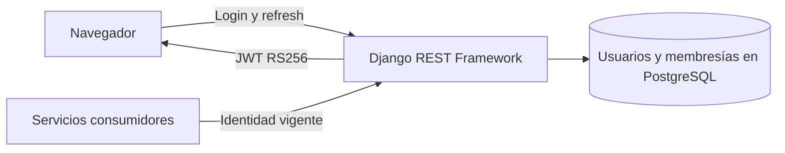

# AuthServices

Identidad, sesión JWT RS256, usuarios y administración de membresías de empresa.

## Recorrido



## Arranque local

Configura el entorno según el [README del proyecto](../../README.md#probar-en-local) y ejecuta desde la raíz.

```powershell
docker compose --env-file .env -f docker/docker-compose.yml up -d --build --wait auth-service
```

Puerto local **8001**.

El bootstrap crea el administrador después de las migraciones y conserva cualquier superusuario existente. [Django Admin](http://localhost:8001/admin/) · [Swagger](http://localhost:8001/docs/api/schema/swagger-ui/)

## Guías

- [Contrato de API y JWT](docs/API.md).
- [Operación, claves y migraciones](docs/OPERATIONS.md).
- [Pruebas de Auth y PostgreSQL](docs/TESTS.md).
- [Instrucciones del componente](AGENTS.md) y [skill documental-auth](../../.agents/skills/documental-auth/SKILL.md).
- [Mapa del backend](../README.md) y [verificación de entrega](../../docs/release/README.md).
