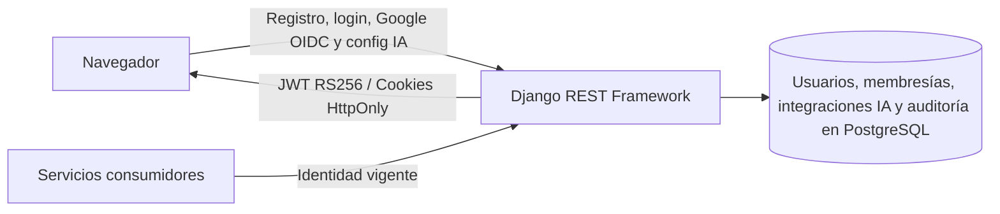

# AuthServices

Identidad, sesión JWT RS256 (y cookies `HttpOnly` opcionales), registro tradicional con bootstrap transaccional de la primera cuenta administradora, inicio de sesión opcional con Google (OIDC/OAuth 2.0), administración multiempresa, auditoría persistente (`/api/audit-logs/`) y configuración de proveedores de IA (`/api/integrations/ai/provider/`, `/api/integrations/groq/*`, `/api/integrations/ollama/*`).

## Recorrido



## Arranque local

Ejecuta desde la raíz del proyecto (ver [instalación rápida](../../README.md#instalación-rápida-1-comando)):

```bash
docker compose up -d --build --wait auth-service
```

Puerto local **8001**.

Si no defines `INITIAL_ADMIN_USERNAME`/`INITIAL_ADMIN_PASSWORD`, `ALLOW_WEB_SETUP=true` permite crear la primera cuenta administradora directamente desde `http://localhost:3000`. [Django Admin](http://localhost:8001/admin/) · [Swagger](http://localhost:8001/docs/api/schema/swagger-ui/)

## Guías

- [Contrato de API y JWT](docs/API.md).
- [Operación, claves y migraciones](docs/OPERATIONS.md).
- [Pruebas de Auth y PostgreSQL](docs/TESTS.md).
- [Instrucciones del componente](AGENTS.md) y [skill documental-auth](../../.agents/skills/documental-auth/SKILL.md).
- [Mapa del backend](../README.md) y [verificación de entrega](../../docs/release/README.md).
