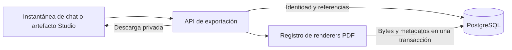

# DocumentExportServices

Genera y almacena PDFs con historial y descarga privados mediante un registro extensible de renderers (`chat_snapshot` para instantáneas de chat y `studio_artifact` para artefactos de Knowledge Studio).

## Recorrido



## Arranque local

Ejecuta desde la raíz del proyecto (ver [instalación rápida](../../README.md#instalación-rápida-1-comando)):

```bash
docker compose up -d --build --wait document-export-service
```

Puerto local **8016**.

## Guías

- [Contrato HTTP y autorización](docs/REFERENCE.md#contrato-actual).
- [Operación y configuración](docs/REFERENCE.md#ejecución-actual).
- [Pruebas y evidencia](docs/REFERENCE.md#verificación).
- [Instrucciones del componente](AGENTS.md) y [skill documental-export](../../.agents/skills/documental-export/SKILL.md).
- [Mapa del backend](../README.md) y [verificación de entrega](../../docs/release/README.md).
