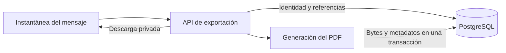

# DocumentExportServices

Genera y almacena el PDF de una instantánea de chat con historial y descarga privados.

## Recorrido



## Arranque local

Configura el entorno según el [README del proyecto](../../README.md#probar-en-local) y ejecuta desde la raíz.

```powershell
docker compose --env-file .env -f docker/docker-compose.yml up -d --build --wait document-export-service
```

Puerto local **8016**.

## Guías

- [Contrato HTTP y autorización](docs/REFERENCE.md#contrato-actual).
- [Operación y configuración](docs/REFERENCE.md#ejecución-actual).
- [Pruebas y evidencia](docs/REFERENCE.md#verificación).
- [Instrucciones del componente](AGENTS.md) y [skill documental-export](../../.agents/skills/documental-export/SKILL.md).
- [Mapa del backend](../README.md) y [verificación de entrega](../../docs/release/README.md).
