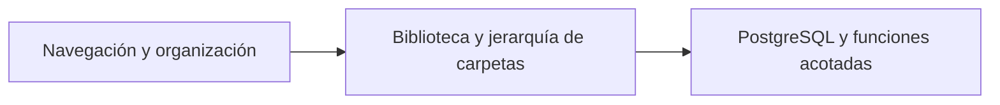

# DocumentLibraryServices

Organiza carpetas, favoritos y documentos recientes dentro de la biblioteca autorizada.

## Recorrido



## Arranque local

Ejecuta desde la raíz del proyecto (ver [instalación rápida](../../README.md#instalación-rápida-1-comando)):

```bash
docker compose up -d --build --wait document-library-service
```

Puerto local **8006**.

## Guías

- [Contrato HTTP y autorización](docs/REFERENCE.md#contrato-http-actual).
- [Operación y configuración](docs/REFERENCE.md#arranque-y-permisos).
- [Pruebas y evidencia](docs/REFERENCE.md#pruebas).
- [Instrucciones del componente](AGENTS.md) y [skill documental-library](../../.agents/skills/documental-library/SKILL.md).
- [Mapa del backend](../README.md) y [verificación de entrega](../../docs/release/README.md).
