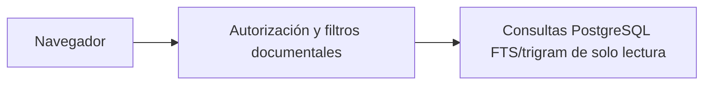

# DocumentSearchServices

Expone búsqueda léxica moderna (PostgreSQL FTS `ts_rank_cd` sobre `content_tsv` + índice trigram `pg_trgm` sobre `filename`), detalle y selección de documentos visibles para la identidad vigente.

## Recorrido



## Arranque local

Ejecuta desde la raíz del proyecto (ver [instalación rápida](../../README.md#instalación-rápida-1-comando)):

```bash
docker compose up -d --build --wait document-search-service
```

Puerto local **8004**.

## Guías

- [Contrato HTTP y autorización](docs/REFERENCE.md#api-endpoints).
- [Operación y configuración](docs/REFERENCE.md#running-the-service).
- [Pruebas y evidencia](docs/REFERENCE.md#verificación-de-la-imagen).
- [Instrucciones del componente](AGENTS.md) y [skill documental-search](../../.agents/skills/documental-search/SKILL.md).
- [Mapa del backend](../README.md) y [verificación de entrega](../../docs/release/README.md).
