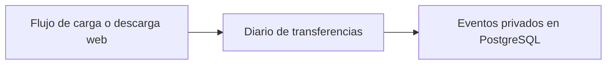

# DocumentTransferServices

Registra el historial privado de cargas y descargas que comunica la web.

## Recorrido



## Arranque local

Configura el entorno según el [README del proyecto](../../README.md#probar-en-local) y ejecuta desde la raíz.

```powershell
docker compose --env-file .env -f docker/docker-compose.yml up -d --build --wait document-transfer-service
```

Puerto local **8007**.

## Guías

- [Contrato HTTP y autorización](docs/REFERENCE.md#contrato-http).
- [Operación y configuración](docs/REFERENCE.md#operación).
- [Pruebas y evidencia](docs/REFERENCE.md#validación-y-límites-de-la-evidencia).
- [Instrucciones del componente](AGENTS.md) y [skill documental-transfer](../../.agents/skills/documental-transfer/SKILL.md).
- [Mapa del backend](../README.md) y [verificación de entrega](../../docs/release/README.md).
