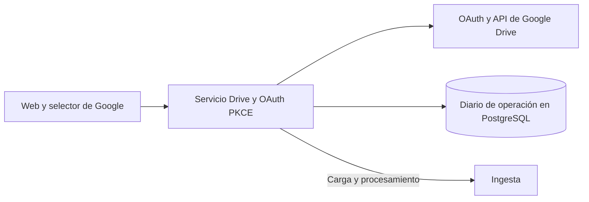

# GoogleDriveImportServices

Conecta Google Drive mediante OAuth PKCE y coordina importaciones recuperables hacia Ingesta.

## Recorrido



## Arranque local

Configura el entorno según el [README del proyecto](../../README.md#probar-en-local) y ejecuta desde la raíz.

```powershell
docker compose --env-file .env -f docker/docker-compose.yml up -d --build --wait google-drive-import-service
```

Puerto local **8017**.

La integración arranca deshabilitada. La guía de operación explica cómo habilitar OAuth y recuperar importaciones.

## Guías

- [Contrato HTTP y autorización](docs/REFERENCE.md#endpoints).
- [Operación y configuración](docs/REFERENCE.md#operación-drive-002003).
- [Validación del servicio](docs/REFERENCE.md#validación-del-paquete) y [pruebas del escritor de carpetas](docs/REFERENCE.md#pruebas-del-escritor-de-carpetas).
- [Instrucciones del componente](AGENTS.md) y [skill documental-drive](../../.agents/skills/documental-drive/SKILL.md).
- [Mapa del backend](../README.md) y [verificación de entrega](../../docs/release/README.md).
