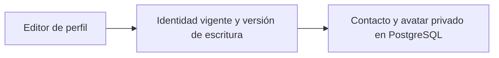

# ProfileServices

Gestiona el perfil de contacto y el avatar privado de la cuenta autenticada.

## Recorrido



## Arranque local

Configura el entorno según el [README del proyecto](../../README.md#probar-en-local) y ejecuta desde la raíz.

```powershell
docker compose --env-file .env -f docker/docker-compose.yml up -d --build --wait profile-service
```

Puerto local **8015**.

## Guías

- [Contrato HTTP y autorización](docs/REFERENCE.md#contrato-actual).
- [Operación y configuración](docs/REFERENCE.md#arranque-y-configuración-actuales).
- [Pruebas y evidencia](docs/REFERENCE.md#pruebas-y-auditoría).
- [Instrucciones del componente](AGENTS.md) y [skill documental-profile](../../.agents/skills/documental-profile/SKILL.md).
- [Mapa del backend](../README.md) y [verificación de entrega](../../docs/release/README.md).
