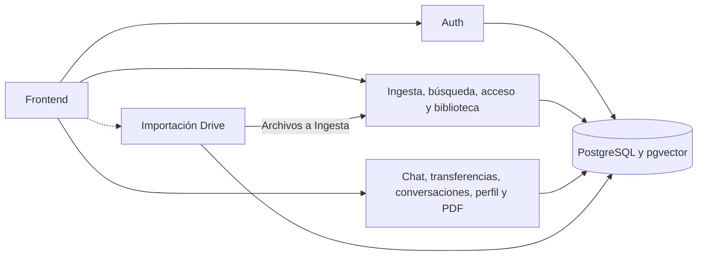

# Backend documental

Once APIs cubren identidad, gestión documental, colaboración e importación. PostgreSQL comparte los datos entre dominios mediante roles de ejecución por servicio. Auth emite JWT y mantiene identidad y membresías. Ingesta y Acceso comparten el volumen de originales.

## Servicios

| API | Puerto | Responsabilidad |
| --- | ---: | --- |
| [AuthServices](AuthServices/README.md) | 8001 | Identidad, sesión JWT RS256, usuarios y administración de membresías de empresa. |
| [RagDocumentEmbeddingServices](RagDocumentEmbeddingServices/README.md) | 8003 | Recibe archivos, conserva el original y genera fragmentos y embeddings locales para su recuperación. |
| [RagDocumentChatServices](RagDocumentChatServices/README.md) | 8002 | Recupera fragmentos autorizados y devuelve respuestas con fuentes a partir del contexto documental. |
| [DocumentSearchServices](DocumentSearchServices/README.md) | 8004 | Expone búsqueda, detalle y selección de documentos visibles para la identidad vigente. |
| [DocumentAccessServices](DocumentAccessServices/README.md) | 8005 | Entrega contenido y originales autorizados y coordina el borrado documental. |
| [DocumentLibraryServices](DocumentLibraryServices/README.md) | 8006 | Organiza carpetas, favoritos y documentos recientes dentro de la biblioteca autorizada. |
| [DocumentTransferServices](DocumentTransferServices/README.md) | 8007 | Registra el historial privado de cargas y descargas que comunica la web. |
| [ConversationServices](ConversationServices/README.md) | 8008 | Persiste conversaciones y mensajes privados del chat documental y sus vínculos autorizados. |
| [ProfileServices](ProfileServices/README.md) | 8015 | Gestiona el perfil de contacto y el avatar privado de la cuenta autenticada. |
| [DocumentExportServices](DocumentExportServices/README.md) | 8016 | Genera y almacena el PDF de una instantánea de chat con historial y descarga privados. |
| [GoogleDriveImportServices](GoogleDriveImportServices/README.md) | 8017 | Conecta Google Drive mediante OAuth PKCE y coordina importaciones recuperables hacia Ingesta. |

## Guías

- [Integración entre servicios](docs/INTEGRATION.md) para autoridad, datos compartidos y cambios de contrato.
- [Arquitectura del proyecto](../docs/architecture.md) y [operación local](../docs/operations.md).
- [Base de datos](../scripts/database/README.md).
- [Instrucciones del backend](AGENTS.md) y [skill de integración](../.agents/skills/documental-backend/SKILL.md).
