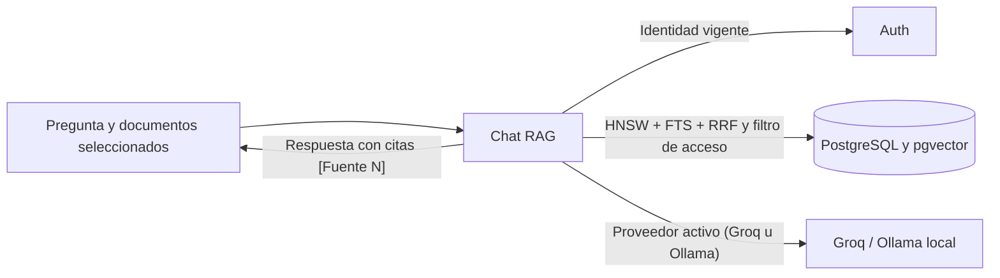

# RagDocumentChatServices

Recuperación híbrida autorizada (`pgvector` HNSW + búsqueda léxica FTS fusionada con Reciprocal Rank Fusion), blindaje anti *prompt-injection* (`<document_context>`), respuestas con citas verificables `[Fuente N]`, streaming SSE opcional (`?stream=true`), historial unificado en `conversation_messages` y enrutamiento dinámico entre **Groq** (nube) y **Ollama local** sin reiniciar contenedores.

## Recorrido



## Arranque local

Ejecuta desde la raíz del proyecto (ver [instalación rápida](../../README.md#instalación-rápida-1-comando)):

```bash
docker compose up -d --build --wait rag-document-chat-service
```

Puerto local **8002**.

## Guías

- [Contrato HTTP y autorización](docs/REFERENCE.md#api-endpoints).
- [Operación y configuración](docs/REFERENCE.md#running-the-service).
- [Extensibilidad LLM y MCP](../../docs/ADR_EXTENSIBILITY_LLM_MCP.md).
- [Instrucciones del componente](AGENTS.md) y [skill documental-rag](../../.agents/skills/documental-rag/SKILL.md).
- [Mapa del backend](../README.md) y [verificación de entrega](../../docs/release/README.md).
