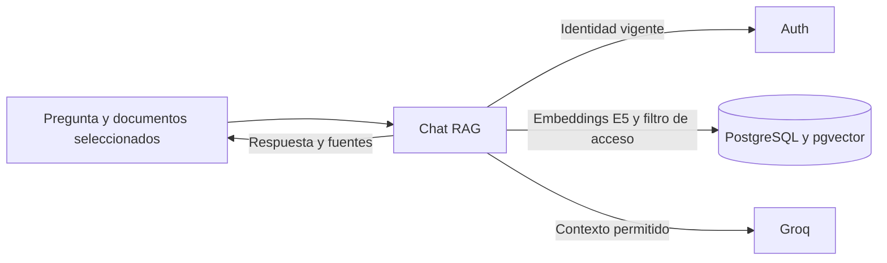

# RagDocumentChatServices

Recupera fragmentos autorizados y devuelve respuestas con fuentes a partir del contexto documental.

## Recorrido



## Arranque local

Configura el entorno según el [README del proyecto](../../README.md#probar-en-local) y ejecuta desde la raíz.

```powershell
docker compose --env-file .env -f docker/docker-compose.yml up -d --build --wait rag-document-chat-service
```

Puerto local **8002**.

## Guías

- [Contrato HTTP y autorización](docs/REFERENCE.md#api-endpoints).
- [Operación y configuración](docs/REFERENCE.md#running-the-service).
- [Instrucciones del componente](AGENTS.md) y [skill documental-rag](../../.agents/skills/documental-rag/SKILL.md).
- [Mapa del backend](../README.md) y [verificación de entrega](../../docs/release/README.md).
