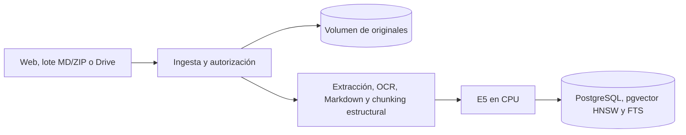

# RagDocumentEmbeddingServices

Recibe archivos individuales (`POST /api/v1/documents/upload` con idempotencia por `Idempotency-Key` y `content_sha256`) o lotes Markdown/ZIP (`POST /api/v1/documents/import-batch` con protección anti zip-bomb, symlinks y path-traversal), conserva el original, normaliza Markdown (YAML frontmatter, `[[wikilinks]]`, `#tags`), ejecuta chunking estructural con `metadata.page`/`section` y genera embeddings locales (`intfloat/multilingual-e5-small`) en CPU.

## Recorrido



## Arranque local

Ejecuta desde la raíz del proyecto (ver [instalación rápida](../../README.md#instalación-rápida-1-comando)):

```bash
docker compose up -d --build --wait rag-document-embedding-service
```

Puerto local **8003**.

## Guías

- [Contrato HTTP y autorización](docs/REFERENCE.md#api-endpoints).
- [Operación y configuración](docs/REFERENCE.md#running-the-service).
- [Instrucciones del componente](AGENTS.md) y [skill documental-ingest](../../.agents/skills/documental-ingest/SKILL.md).
- [Mapa del backend](../README.md) y [verificación de entrega](../../docs/release/README.md).
