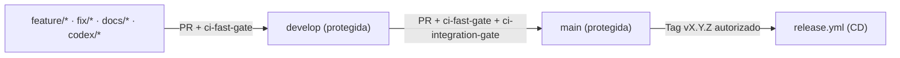

# Estrategia de CI/CD y Ramas — Blandskron Documental

Esta guía documenta la auditoría de GitHub Actions, la estrategia de ramas (`main`, `develop`, `feature/*`, tags `v*`), la separación entre CI rápido, integración completa y CD, la configuración recomendada de protección de ramas y el plan de migración para PRs abiertos.

---

## 1. Diagnóstico de la línea base (estado anterior)

Hasta el commit `055a85d`, un único workflow (`.github/workflows/validate.yml`) ejecutaba 7 jobs en paralelo en cada Pull Request y cada push a `main`, sin `concurrency`, sin filtrado de rutas, sin caché de capas Docker y sin pipeline CD separado.

### Tiempos medidos en GitHub Actions (runs `44140675146`, `44143081824`, `44856352253`)

| Job heredado | Cola runner | Duración real | Problema principal |
| --- | ---: | ---: | --- |
| `compose` | 1–2 s | 7–8 s | Repetido también al inicio de `verify.mjs`. |
| `rag-groq` | 1–3 s | 11–24 s | Subconjunto de `rag-chat-tests`, repetido en `release`. |
| `postgres` | 1–2 s | 46–57 s | Sin caché Buildx para imagen Postgres. |
| `auth` | 1–2 s | 59–69 s | `manage.py test` repetido después en `release`. |
| `frontend` | 1–2 s | 1.6–2.6 min | Bien aislado con Playwright fijo y caché npm. |
| `auth-db-roles` | 1–2 s | **9.4–10.5 min** | Solapaba ~80% de `release`; recompilaba `embedding-tests` (Tesseract 5.5.4 + PyTorch CPU) sin caché en cada run. |
| `release` | 1–2 s | **12.8–15.7 min** | **No publicaba versiones.** Construía las 13 imágenes sin caché (5.1–6.8 min), corría 88 pasos secuenciales (5.6–6.9 min) y escaneaba Trivy sin caché DB (1.6–1.8 min). |
| **Total por PR** | **1–3 s** | **12.8–15.7 min wall-clock** | **26.5–30.1 min de Actions facturados por push** (incluso en PRs solo de Markdown). |

- **Tasa de fallos observada (últimos 15 runs):** 2/15 fallos (13.3%) + 2/15 cancelaciones manuales (13.3%) por ausencia de `concurrency`.

---

## 2. Estrategia de ramas



| Rama / Referencia | Rol | Reglas |
| --- | --- | --- |
| `main` | Rama estable lista para entrega | Protegida. Recibe cambios solo mediante PR desde `develop` (o `hotfix/*` en emergencias). Requiere `ci-fast-gate` y `ci-integration-gate`. |
| `develop` | Rama de integración continua | Protegida. Creada desde `main` (`055a85d`). Recibe PRs desde `feature/*`, `fix/*`, `docs/*`, `codex/*` y `dependabot/*`. Requiere `ci-fast-gate`. Corre integración nocturna diaria (`schedule`). |
| `feature/*`, `fix/*`, `docs/*`, `codex/*` | Ramas temporales de desarrollo (humanos y agentes) | Nacen desde `develop`, apuntan por PR a `develop` y se eliminan tras el merge. |
| Tags `v*` (ej. `v0.2.0`) | Publicación controlada de versiones | Solo sobre commits ya integrados en `origin/main` (verificado por `release.yml`). |

---

## 3. Arquitectura de workflows (CI vs CD)

| Workflow | Archivo | Triggers | Checks requeridos |
| --- | --- | --- | --- |
| **CI Rápido** | [ci-fast.yml](../.github/workflows/ci-fast.yml) | `pull_request` (`develop`, `main`), `push` (`develop`), `workflow_dispatch` | **`ci-fast-gate`** (en `develop` y `main`) |
| **CI Integración y Seguridad** | [ci-integration.yml](../.github/workflows/ci-integration.yml) | `pull_request` (`main`), `push` (`main`), `schedule` nocturno (`04:00 UTC` sobre `develop`), `workflow_dispatch`, `workflow_call` | **`ci-integration-gate`** (en `main`) |
| **Release (CD)** | [release.yml](../.github/workflows/release.yml) | `push` tags `v[0-9]+.[0-9]+.[0-9]+*`, `workflow_dispatch` | — (nunca corre en PRs) |

### Cómo se evita el bloqueo de checks requeridos (`Gate Pattern`)

- `ci-fast.yml` usa [scripts/ci/detect_changes.py](../scripts/ci/detect_changes.py) para ejecutar únicamente los ámbitos afectados en PRs hacia `develop` (y fuerza el set completo en PRs hacia `main` o cambios globales de infraestructura/Compose/workflows).
- El job final **`ci-fast-gate`** corre con `if: always()` y falla si cualquier job necesario terminó en `failure` o `cancelled`, aprobando si todos fueron `success` o `skipped`.
- Así el check requerido `ci-fast-gate` **siempre completa** y nunca queda en estado *Expected / Pending*.

### Eliminación de duplicación y aceleración sin sacrificar cobertura

1. **Caché de capas Docker BuildKit (`type=gha`):** definida en [docker/compose/ci-cache.yml](../docker/compose/ci-cache.yml) (activada automáticamente con `COMPOSE_BAKE=true` en PRs del mismo repositorio; omitida en PRs de forks para evitar errores de escritura de caché). Evita recompilar Tesseract 5.5.4 y reinstalar PyTorch CPU + E5 471 MB en cada ejecución.
2. **Paralelización real en `ci-integration.yml`:**
   - `db-concurrency-and-roles`: ejecuta una sola vez los 11 `verify_role.sql`, `tenant_preflight.sql`, las 4 suites SQL concurrentes (`assignments`, `relations` + `embedding-tests` races, `hierarchy`, `identity`) y la preservación histórica.
   - `service-contracts-and-audits`: ejecuta en paralelo los 6 `*-audit` (`pip-audit`), `audit_owners.sql`, `verify_auth_contract.py` (profile/export/drive), restarts y checks de hardening (`zlib1g`, `/tmp` `0700`).
   - `e2e-and-image-audit`: levanta el entorno sintético `bd-final-check`, corre `node scripts/release/verify.mjs --skip-relations` (Compose, storage, E5 offline, Auth, los 10 `*-tests` + `ruff`, demo E2E, upload perdido, reinicio/persistencia y postflight), audita las 13 imágenes con Trivy reutilizando caché de DB (`/tmp/bd-release-audit-ci/cache`) y valida grafos con `verify_graphs.mjs`.
3. **Hardening de seguridad en Actions:**
   - `permissions: { contents: read }` en todos los workflows; `contents: write` limitado exclusivamente al job `publish-release` de `release.yml`.
   - Todas las Actions externas fijadas por **commit SHA** con soporte nativo de Node 24.
   - `concurrency` con `cancel-in-progress: true` en PRs y `false` en `main`/releases.
   - `timeout-minutes` explícitos en cada job (5 a 35 min).
   - Credenciales 100% sintéticas vía [prepare_verification.mjs](../scripts/release/prepare_verification.mjs); sin `pull_request_target` ni exposición de secretos a código no confiable.

---

## 4. Protección de ramas recomendada (GitHub Rulesets)

Configura dos Rulesets de rama y uno de tags en **Settings → Rules → Rulesets** (o vía `gh api` con token admin):

### Ruleset 1: `main`
- **Target:** `refs/heads/main`
- **Reglas:**
  - Restrict deletions + Block force pushes.
  - Require a pull request before merging (Dismiss stale approvals, Require conversation resolution).
  - Require status checks to pass before merging (**Require branches to be up to date**):
    - `ci-fast-gate`
    - `ci-integration-gate`

### Ruleset 2: `develop`
- **Target:** `refs/heads/develop`
- **Reglas:**
  - Restrict deletions + Block force pushes.
  - Require a pull request before merging (Require conversation resolution).
  - Require status checks to pass before merging:
    - `ci-fast-gate`

### Ruleset 3: Tags `v*`
- **Target:** `refs/tags/v*`
- **Reglas:** Restrict creations, updates y deletions salvo bypass de administradores/mantenedores.

> **Transición atómica de checks en `main`:** al abrir el PR de esta migración hacia `main`, espera a que `ci-fast-gate` y `ci-integration-gate` aparezcan en verde, añade ambos como Required en `main` y retira los 7 checks antiguos (`auth`, `auth-db-roles`, `compose`, `frontend`, `postgres`, `rag-groq`, `release`). Así `main` nunca queda desprotegida.

---

## 5. Plan seguro de migración para PR #97

1. Publicar la rama `develop` (ya creada desde `main` `055a85d`): `git push -u origin develop`.
2. Integrar `feature/ci-cd-optimization` en `main` (y avanzar `develop` a `main`) actualizando los Required Status Checks según la sección 4.
3. En GitHub, editar **PR #97** (`rag-core-evolution-audit-6ac6c`) y cambiar su rama base de `main` a `develop`.
   - Como `develop` comparte ancestro con `main`, el diff de PR #97 permanece idéntico (solo `docs/` y `roadmap.md`).
   - PR #97 ejecutará `ci-fast-gate` (validando `docs-links` en ~20–30 s) y podrá integrarse a `develop` sin quedar bloqueado por el escaneo de imágenes Docker.

---

## 6. Comparación de tiempos (antes vs objetivo tras migración)

| Escenario | Antes (medido) | Después (estimado con caché) | Mejora |
| --- | ---: | ---: | ---: |
| PR de documentación (`docs/`, `*.md`) → `develop` | 12.8–15.7 min (~28 min Actions) | **~20–35 s** (~0.5 min Actions) | **~96%** |
| PR de Knowledge Studio / eval (`backend/KnowledgeStudioServices/`, `scripts/eval/`) → `develop` | N/A | **~15–25 s** (`studio-eval-fast`) | Gate dedicado |
| PR de 1–2 servicios backend → `develop` | 12.8–15.7 min (~28 min Actions) | **~1.5–2.5 min** (~2–4 min Actions) | **~84%** |
| PR de frontend → `develop` | 12.8–15.7 min (~28 min Actions) | **~1.8–2.6 min** (~2.5 min Actions) | **~83%** |
| PR de BD / Auth → `develop` | 12.8–15.7 min (~28 min Actions) | **~2.0–3.0 min** (~3–4 min Actions) | **~80%** |
| PR de integración `develop → main` | 12.8–15.7 min (~28–30 min Actions) | **~5–7 min** (~12–16 min Actions) | **~50–55%** |
| Publicación de release (tag `v*`) | No existía | **~6–8 min** (solo en tags) | CD controlado |

---

## 7. Flujo diario para desarrolladores y agentes

1. Actualiza `develop` y crea una rama temporal:
   ```bash
   git checkout develop && git pull --ff-only origin develop
   git checkout -b feature/<slug>   # o codex/<slug>, fix/<slug>, docs/<slug>
   ```
2. Abre PR hacia **`develop`**. Espera `ci-fast-gate` en verde y haz merge.
3. Cuando el lote en `develop` esté listo para entrega, abre PR **`develop` → `main`**. Espera `ci-fast-gate` + `ci-integration-gate` en verde y haz merge.
4. Para publicar una versión desde `main`:
   ```bash
   git checkout main && git pull --ff-only origin main
   git tag -a v0.2.0 -m "Blandskron Documental v0.2.0"
   git push origin v0.2.0
   ```
   `release.yml` verificará que el commit pertenece a `origin/main`, ejecutará la suite de integración completa y publicará el GitHub Release con reportes y `SHA256SUMS.txt`.

