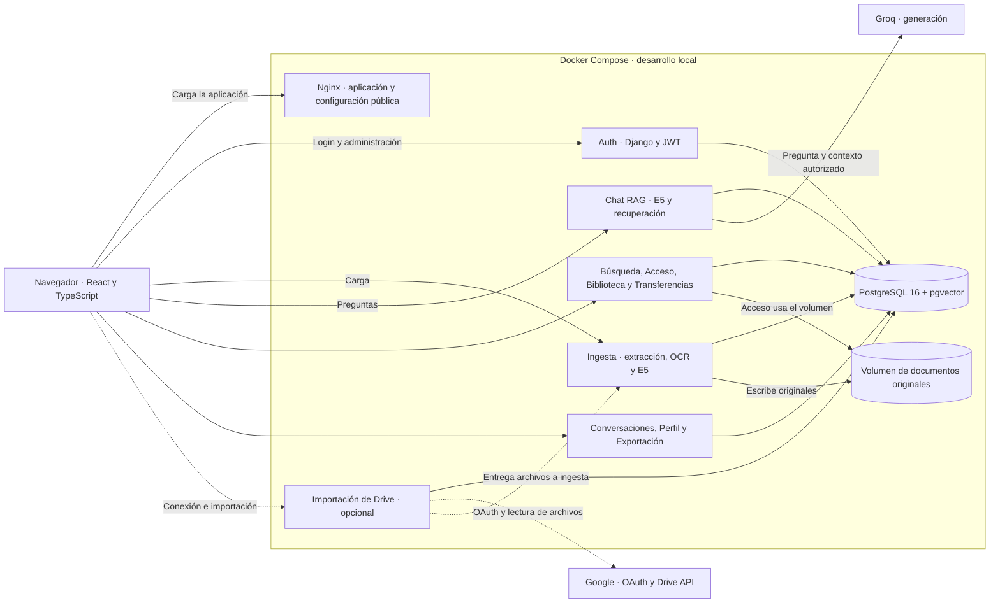
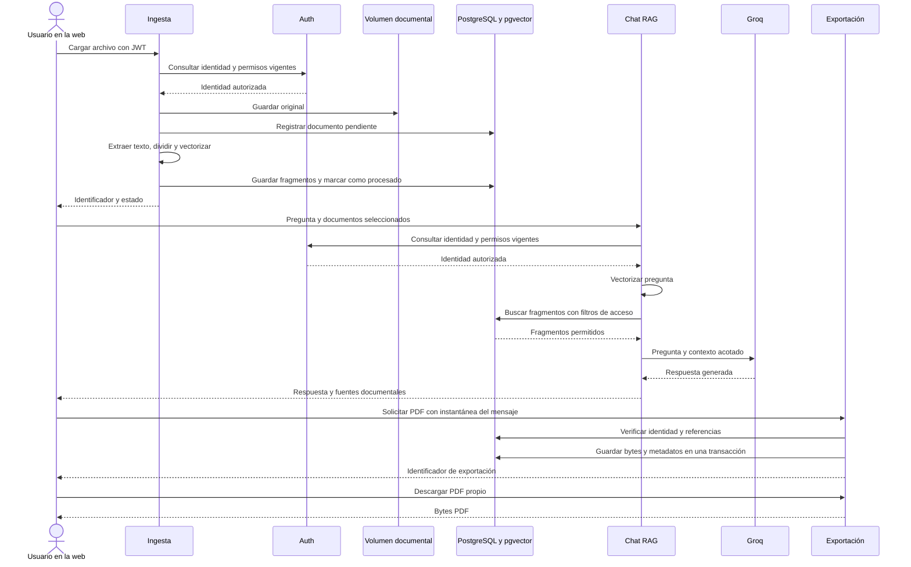

# Arquitectura

## Topología y límites de confianza

La web estática se sirve mediante Nginx. El navegador consume las APIs directamente por HTTP en loopback con las URL públicas configuradas en Compose. Los servicios comparten la base `documents_db` de PostgreSQL 16, con roles de ejecución por servicio. Ingesta y Acceso comparten el volumen de archivos originales. Los grupos del diagrama representan responsabilidades y cada fila de la tabla identifica una API desplegable.

Los servicios documentales que usan `AUTH_IDENTITY_URL` verifican localmente firma y expiración del JWT y consultan `/api/users/me/` para obtener la identidad y los permisos vigentes. Una cuenta deshabilitada o un permiso retirado afecta a la siguiente operación protegida. Si Auth falla, las APIs que dependen de esa consulta responden 503. La clave privada de firma queda en Auth y los consumidores montan la clave pública en solo lectura. Los contratos de Perfil y Exportación detallan sus comprobaciones de sesión y propiedad. [Operación de Auth](../backend/AuthServices/docs/OPERATIONS.md) · [Perfil](../backend/ProfileServices/README.md) · [Exportación](../backend/DocumentExportServices/README.md)

La visibilidad de documentos se evalúa en el servidor. En el chat, los filtros de acceso se aplican en la recuperación de fragmentos, antes de construir el contexto que cruza el límite externo hacia Groq. Las restricciones SQL mantienen relaciones válidas entre empresa, área, jerarquía y membresías. [Chat RAG](../backend/RagDocumentChatServices/README.md) · [Esquema y preflight](../scripts/database/README.md)

## De la carga a la respuesta y al PDF

La secuencia muestra una carga con procesamiento inmediato y una pregunta vectorial normal. La ingesta conserva el original, extrae texto con OCR cuando corresponde, divide el contenido y genera vectores de 384 dimensiones con `intfloat/multilingual-e5-small`. El chat usa el mismo modelo para la pregunta. Para resumir documentos seleccionados, puede recuperar su contexto directamente según el contrato de RAG.

Las fuentes de chat incluyen identificadores de documento y fragmento. La exportación recibe la instantánea desde la web y valida las referencias persistidas cuando se incluyen. Si el mensaje todavía es local, el PDF puede guardarse sin vincularlo a ese mensaje. Una clave de operación conserva la idempotencia ante reintentos. [Contrato de ingesta](../backend/RagDocumentEmbeddingServices/README.md) · [Contrato de chat](../backend/RagDocumentChatServices/README.md) · [Contrato de exportación](../backend/DocumentExportServices/README.md)

## Mapa de servicios

Los puertos son los del host en la configuración local predeterminada.

| Servicio | Puerto | Responsabilidad |
| --- | ---: | --- |
| [Frontend](../frontend/README.md) | 3000 | Sesión, biblioteca, chat, gestión e integraciones. |
| [Auth](../backend/AuthServices/README.md) | 8001 | Usuarios, permisos, membresías e identidad JWT. |
| [Chat RAG](../backend/RagDocumentChatServices/README.md) | 8002 | Recuperación autorizada y respuestas con fuentes. |
| [Ingesta](../backend/RagDocumentEmbeddingServices/README.md) | 8003 | Almacenamiento, extracción, indexación y reindexación. |
| [Búsqueda](../backend/DocumentSearchServices/README.md) | 8004 | Búsqueda, detalle y selección documental. |
| [Acceso](../backend/DocumentAccessServices/README.md) | 8005 | Contenido, vista previa, descarga y borrado. |
| [Biblioteca](../backend/DocumentLibraryServices/README.md) | 8006 | Carpetas, favoritos y documentos recientes. |
| [Transferencias](../backend/DocumentTransferServices/README.md) | 8007 | Historial de cargas y descargas. |
| [Conversaciones](../backend/ConversationServices/README.md) | 8008 | Historial y mensajes de chat. |
| [Perfil](../backend/ProfileServices/README.md) | 8015 | Perfil personal y avatar privado. |
| [Exportación](../backend/DocumentExportServices/README.md) | 8016 | PDF, historial propio y descarga. |
| [Google Drive](../backend/GoogleDriveImportServices/README.md) | 8017 | OAuth con PKCE S256, importación acotada e historial. |
