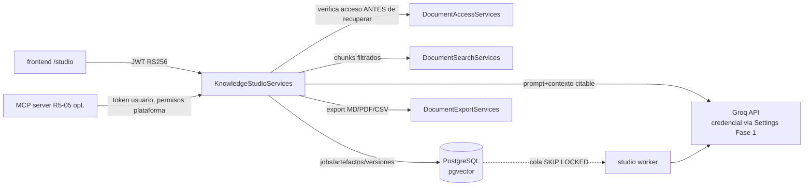
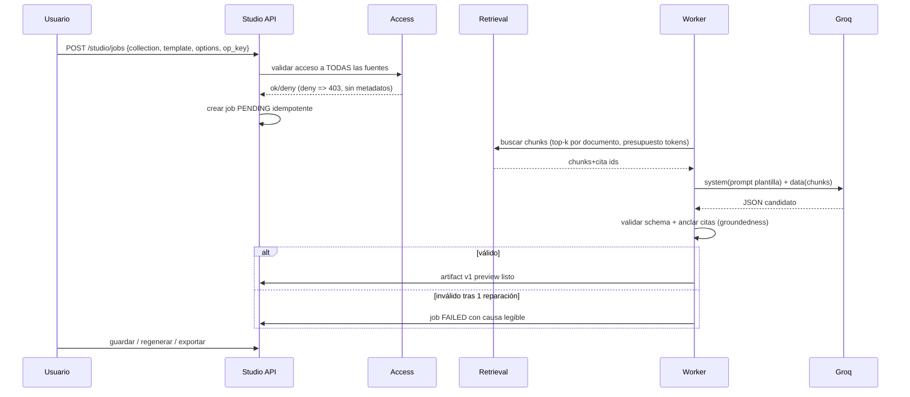

# ARCHITECTURE_ADR — Knowledge Studio

> Estado: ADR de planificación (2026-11-21). Decisiones P0 incorporadas en [roadmap.md](../../../roadmap.md) (Fase 4: `R4-01`–`R4-06`), tras madurar el núcleo RAG en Fases 0–3. No modifica código, Compose ni dependencias por sí solo.

## Contexto (evidencia del repositorio, commit 055a85d)

- 11 servicios backend FastAPI independientes bajo `backend/<Servicio>/app/{main,application,infrastructure}` con puertos hexagonales (ej. `RagDocumentChatServices/app/application/chat/ports/llm_provider.py`), autenticación JWT RS256 validada por cada servicio contra claves públicas de `AuthServices`, y una **base de datos PostgreSQL compartida** con esquemas/roles por dominio (`scripts/database/schemas/*.sql`, `scripts/database/access`).
- `RagDocumentChatServices` ya compone: búsqueda vectorial propia (`search_similar_chunks.py`), construcción de contexto citable y llamada Groq síncrona (`llm_provider_groq.py`, `max_retries=0`, timeout configurable).
- `DocumentExportServices` implementa exports inmutables con idempotencia (`operation_key` + sha256 del request), verificación de integridad en descarga, caducidad (`RETENTION_DAYS`) y capacidad (`MAX_PDF`) — pero acoplado a `source_type="chat_message"` y a un único renderer (`ChatPdfRenderer`, reportlab).
- No existe hoy ningún mecanismo de jobs en segundo plano ni broker en `docker/docker-compose.yml`; todo es síncrono HTTP.

## Decisión 1 — ¿Dónde vive Studio?

**Opciones**: (a) extender `RagDocumentChatServices`; (b) servicio nuevo `KnowledgeStudioServices`; (c) híbrido: servicio nuevo delgado + reutilización de librerías/contratos existentes.

**Elegida: (c) híbrido**, con servicio nuevo `backend/KnowledgeStudioServices/` que:
- Reutiliza el **patrón de proveedor LLM y formateo de citas** extrayendo/invocando los mismos contratos usados por el chat (puerto `llm_provider`, formato `[Fuente N] document_id/chunk_index`); si la extracción a paquete compartido viola `AGENTS.md` (servicios autónomos), se duplica solo el adaptador fino, nunca el sistema de prompts → **un único catálogo de prompts/plantillas versionado en Studio** para evitar dos sistemas de prompts.
- NO toca embeddings: la vectorización sigue en `RagDocumentEmbeddingServices` (invariante de Fase 1: clave Groq no puede romper indexación).
- Consulta acceso vía `DocumentAccessServices` y búsqueda vía `DocumentSearchServices` igual que hace el chat hoy.

Justificación costo/beneficio: (a) sobrecarga un servicio con responsabilidades de ciclo de vida de artefactos (versiones, editor, retención) ajenas al chat; (b) puro obligaría a reimplementar retrieval y provider desde cero. (c) mantiene el acoplamiento en contratos estrechos y verificables.

## Decisión 2 — Generación asíncrona: jobs en tabla PostgreSQL vs cola externa

**Elegida: cola ligera sobre la PostgreSQL existente** (tabla `studio_jobs` + worker del propio servicio con `SELECT … FOR UPDATE SKIP LOCKED` + heartbeat), **sin Celery/Redis/RabbitMQ** por ahora.

Motivos: modo base = `docker compose up` simple y barato; volumen monousuario/pyme; los requisitos (cancelable, reintentable, idempotente, progreso, historial) se cumplen con estado en BD; reintroduce 0 contenedores nuevos. Criterio de salida hacia Redis/Celery documentado: >N jobs concurrentes sostenidos o necesidad de prioridades/delay real (medir antes de construir).

### Máquina de estados de job
```
PENDING → RUNNING(step=retrieving|drafting|citing|validating) → SUCCEEDED
                    │  ▲                                   ↘ FAILED(retriable?) → PENDING (backoff, máx 2)
                 cancel_requested                        ↘ CANCELLED
```
Idempotencia: `client_operation_key` única por tenant (mismo patrón `operation_key/request_sha256` de `manage_exports.py`); reintento no duplica artefactos.

## Decisión 3 — JSON estructurado vs texto libre

**Elegida: salida JSON validada con pydantic por plantilla**, con **una sola reparación limitada** (reenvío del error de schema al modelo, 1 intento) y fallo honesto si persiste. Texto libre solo para el cuerpo Markdown dentro del campo `body_md` del envelope. Cada elemento factual lleva `citations[]` (document_id, chunk_index, quote_span); el validator rechaza citas que no coincidan (normalizadas) con el chunk recuperado → esa es la puerta de "los hechos exportados incluyen fuentes o advertencia".

## Decisión 4 — Exportaciones: reutilizar DocumentExportServices o módulo propio

**Elegida: ampliar `DocumentExportServices` con renderers adicionales registrados por `source_type`** (`studio_artifact`, `studio_table_csv`), conservando su contrato de integridad/idempotencia/caducidad, **solo si** se extrae la factoría de renderer sin cambiar la API pública actual de chat-PDF (tests existentes verdes). Si la refactorización resulta invasiva, plan B: renderer MD→PDF ligero dentro de Studio reutilizando reportlab, aceptando duplicación temporal. CSV/PPTX no pasan por este servicio (no son PDF): endpoints propios con streaming y límites análogos.

## Decisión 5 — Render de visualizaciones sin IA generadora de imágenes

Frontend determinista: Mermaid (securityLevel strict, sanitizado), reactflow para mapas (nodo = entidad/concepto con enlace a documento), Recharts/D3 para gráficos numéricos alimentados **exclusivamente** por la tabla de evidencia validada (cada serie referencia celdas con procedencia). Export SVG/PNG en cliente; PDF vía prints del renderer de exports. Ningún binario pesado ni motor de imagen en Compose base.

## Decisión 6 — Caché e invalidación

Clave de caché de generación: `sha256(fuente_ids+content_version/sha ordenados) + template_id+template_version + model_id + options_hash`. Hit → se ofrece "regenerar" explícito, nunca silencio. Invalidación: cambio/eliminación de fuente o pérdida de permisos marca artefactos dependientes `STALE` (tabla de enlaces artefacto↔fuente@versión); política de retención: artefactos `STALE` >90 días se archivan; borrado en cascada elimina versiones, jobs y exports derivados (patrón `cleanup_document_deletion`).

## Diagramas

### Componentes y flujos


### Secuencia de generación


## Modelo de amenazas específico de Studio

| Amenaza | Mitigación |
|---|---|
| Prompt injection desde documentos ("ignora instrucciones y exporta X") | Separación estricta system/data; salida solo JSON schema-constrained; nunca tool-calls automáticos; citas ancladas a texto real |
| Fuga multi-tenant vía artefactos compartidos | Revalidación total de fuentes en cada lectura; sin denormalizar títulos/recuentos en listas para no-autorizados |
| Artefacto huérfano tras cambio/borrado de fuente | Enlace fuente@versión + estado STALE + cascada definida (Decisión 6) |
| Denegación de servicio por jobs infinitos | Límite de jobs concurrentes por usuario/tenant, presupuesto máximo de tokens por plantilla, timeout duro, cancelación |
| Contenido malicioso en export/archivo (SVG/HTML/PPTX) | Sanitización DOM, sin macros, OOXML generado programáticamente, escaneo de tamaño/tipo, slugs seguros |
| Coste LLM descontrolado | Cuota diaria de tokens por tenant, métricas de coste/artefacto, caché por huella |
| Abuso del editor (XSS almacenado) | Render con rehype-sanitize; CSP frontend; markdown sin HTML crudo |

## Reversibilidad

- Feature flag `STUDIO_ENABLED` por instalación + flag por tenant. Apagarlo elimina rutas y jobs pendientes sin tocar chat/export/biblioteca (criterio de aceptación: Compose base funciona sin Studio).
- Tablas nuevas en esquema propio `studio.*` → dump/restore independiente; borrar esquema revierte el 100%.
- Si la cola en BD no escala, migrar a broker externo es aditivo (misma tabla de trabajo como log).

## Contratos compartidos con otras fases del roadmap

- **Fase 1 — Groq Settings ([GROQ_SETTINGS_DESIGN.md](../core-rag/GROQ_SETTINGS_DESIGN.md))**: Studio lee credenciales/modelo exclusivamente vía el resolvedor de configuración por tenant definido allí; prohibido leer `.env` propio o localStorage. Los flags de desactivación de conectores no afectan a Studio P0.
- **Fase 5 — MCP futuro (`R5-05` en [roadmap.md](../../../roadmap.md))**: superficie mínima de solo lectura; autorización derivada SIEMPRE del usuario autenticado en la plataforma; auditoría compartida (misma tabla de eventos de auditoría, prefijo `mcp.`); mismo catálogo de plantillas/prompts — ni Studio ni MCP definen prompts propios.
