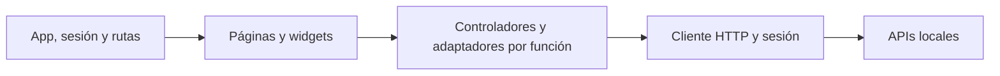

# Frontend documental

Interfaz React, TypeScript estricto y Vite para sesión, biblioteca, chat, perfil y administración. Nginx sirve la compilación en Compose. Durante el desarrollo, Vite escucha en loopback.



## Desarrollo local

Con las APIs activas, ejecuta desde este directorio.

```powershell
npm ci
npm run dev
```

## Guías

- [Arquitectura de código y convenciones](docs/DEVELOPMENT.md#convenciones).
- [Sistema de diseño y accesibilidad](docs/DEVELOPMENT.md#design-system).
- [Pruebas y compilación](docs/DEVELOPMENT.md#verificación).
- [Instrucciones del frontend](AGENTS.md) y [skill del frontend](../.agents/skills/documental-frontend/SKILL.md).
