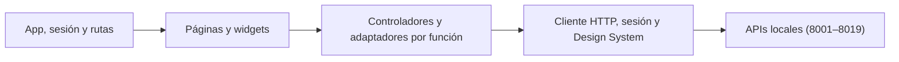

# Frontend documental

Interfaz React 19, TypeScript estricto y Vite para registro/acceso (incluyendo bootstrap inicial y Google OIDC opcional), biblioteca documental, chat unificado en 3 modos (`Chat`, `Agente` y `Code Mode` con citas verificables y `SafeMarkdown` anti-XSS), importación por lote Markdown/ZIP, configuración de IA (Groq u Ollama local en `/settings/ai`), Knowledge Studio (`/studio` con soporte de deep-linking `?artifact=<id>`), auditoría (`/admin/audit`), perfil y administración. Nginx sirve la compilación en Compose sobre loopback (`http://localhost:3000`) con caché inmutable para `/assets/` y cabeceras defensivas (`nosniff`, `DENY`).



## Desarrollo local

Con las APIs activas, ejecuta desde este directorio:

```bash
npm ci
npm run dev
```

## Guías

- [Arquitectura de código y convenciones](docs/DEVELOPMENT.md#convenciones).
- [Sistema de diseño y accesibilidad](docs/DEVELOPMENT.md#design-system).
- [Pruebas y compilación](docs/DEVELOPMENT.md#verificación).
- [Instrucciones del frontend](AGENTS.md) y [skill del frontend](../.agents/skills/documental-frontend/SKILL.md).
