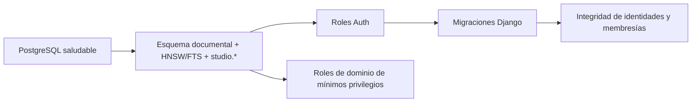

# Base de datos documental

PostgreSQL 16 con `pgvector` y `pg_trgm` almacena identidad, relaciones multiempresa, documentos, fragmentos con vectores HNSW (`vector_cosine_ops`) y FTS (`content_tsv` GIN), integraciones cifradas (`tenant_integrations`), auditoría (`audit_logs`), colaboración y el esquema aislado opcional `studio.*` (con trigger `SECURITY DEFINER` para marcado automático `FRESH -> STALE`). Django migra sus tablas de identidad y SQL mantiene los dominios documentales y los roles de privilegios mínimos (incluyendo `studio_runtime`).

## Guías

- [Arranque y aplicación del esquema](docs/OPERATIONS.md#activación-vigente).
- [Preflight multiempresa](docs/OPERATIONS.md#preflight-multiempresa--plat-001a) y [mapa de escritores](docs/OPERATIONS.md#escritores-y-decisiones-antes-de-imponer-restricciones).
- [Validación SQL sintética y concurrencia](docs/OPERATIONS.md#validación-sintética).
- [Instrucciones del esquema](AGENTS.md) y [skill de migraciones](../../.agents/skills/documental-database/SKILL.md).
